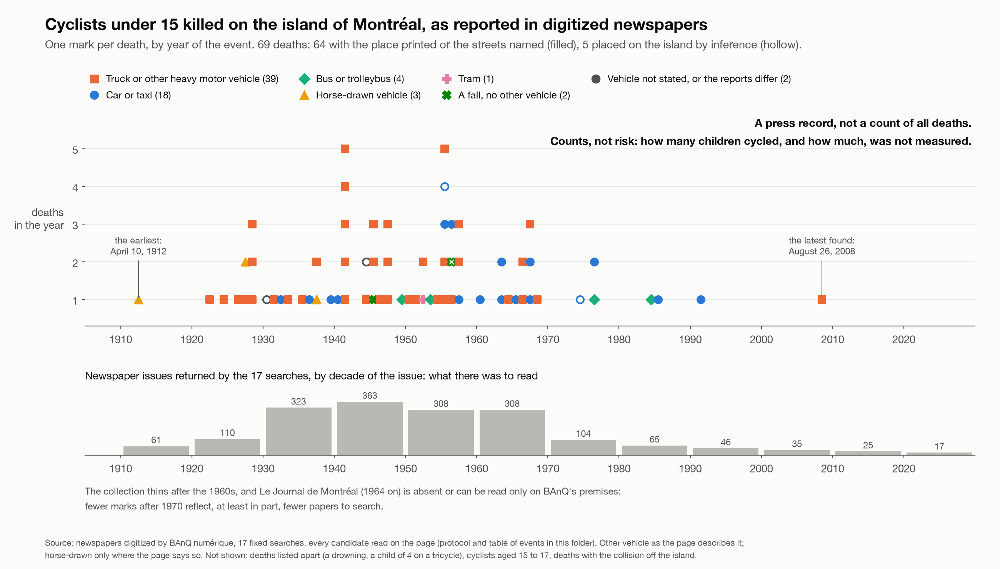
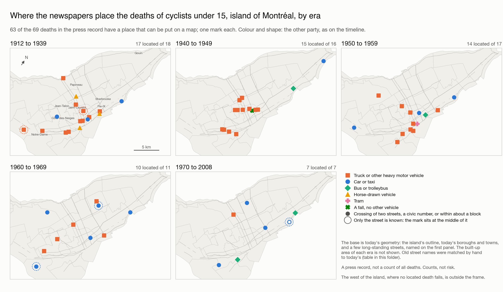

# Young cyclists killed on the island of Montréal, as reported in digitized newspapers, 1898–2008: a press record

**Issued by:** the newspapers themselves (La Presse, La Patrie, Le Devoir, Le Canada, Montréal-Matin, The Montreal Daily Star and others), as digitized by Bibliothèque et Archives nationales du Québec (BAnQ numérique, « Revues et journaux »).
**Dates:** events from July 29, 1898 to August 26, 2008; the pages were searched and read from November 16 to November 26, 2026.
**Obtained:** by 17 searches fixed in advance in BAnQ numérique's full-text search, restricted to papers published on the island of Montréal; every result read as a snippet; every candidate issue then opened and read on the page, in a browser, at a reading pace. No page image is reproduced here and no file was downloaded from the site: each source is given as a link to its page on BAnQ numérique.
**Link status (November 27, 2026):** every link was opened when the page was read. The addresses have the form `numerique.banq.qc.ca/patrimoine/details/52327/<document>?docpos=<page>`; a few issues of Le Journal de Montréal and of The Westmount Examiner can be read only on BAnQ's premises and are not among the sources.

## Why this folder exists

The question was whether cyclists under 15 have been killed in Montréal, how many the press records, when and where. The public data cannot say: the City's collision data (police reports, 2012–2021) and the SAAQ's accident reports carry no age, and Statistics Canada publishes deaths by cause for Canada, not for a city. A search of the recent press is in [`2012-2026-montreal-area-young-road-users-press/`](../2012-2026-montreal-area-young-road-users-press/). This folder goes back as far as the digitized newspapers allow.

It is a **press record, not a census**: a death that no digitized paper reported, or whose text the character recognition garbled, is not here. The counts are counts of what these papers reported; they are not a risk, since nobody measured how many children cycled, or how much, in any of these decades.

## What the record holds

`derived/events.csv` has one row per death of a cyclist confirmed on the page (106 rows), with the date, the age, the place and the other vehicle as printed, and its sources. The names printed by the newspapers are not repeated.

- **Under 15, with the collision on the island: 64 deaths where the page prints the place or names the streets, and 69 with 5 more whose place is not printed and is inferred from the streets, the hospital and the home addresses printed** (column `inference_basis`). Both figures are given wherever a count is given. 4 further deaths under 15 whose place is not printed are placed off the island by the same inference and are in neither figure.
- The earliest of these is of April 10, 1912; the latest is of August 26, 2008 ([La Presse, 2008-08-27, p. A 10 (page 10 of the file)](https://numerique.banq.qc.ca/patrimoine/details/52327/2208613?docpos=10)).
- Listed apart and in no count: 2 (a boy who fell into a canal with his bicycle and drowned, 1932, a child of 4 on a tricycle, 1938).
- Aged 15 to 17: 24 on the island and 2 on a bridge between the island and the south shore. Age not given, or printed as 14 in one paper and 15 in another: 5. These rows are in the table and in no count of the under-15 group. The issues whose snippet showed only an age of 15 to 17 were not opened, so this group is incomplete.

### By decade (under 15, on the island)

| Decade | Place printed or streets named | Placed by inference | Both |
|---|---:|---:|---:|
| 1910s | 1 |  | 1 |
| 1920s | 8 |  | 8 |
| 1930s | 8 | 1 | 9 |
| 1940s | 15 | 1 | 16 |
| 1950s | 15 | 2 | 17 |
| 1960s | 11 |  | 11 |
| 1970s | 2 | 1 | 3 |
| 1980s | 2 |  | 2 |
| 1990s | 1 |  | 1 |
| 2000s | 1 |  | 1 |
| **All** | **64** | **5** | **69** |

The collection of digitized papers is not even over time. The 17 searches returned 1977 distinct issues; by decade of the issue: 1910s 61, 1920s 110, 1930s 323, 1940s 363, 1950s 308, 1960s 308, 1970s 104, 1980s 65, 1990s 46, 2000s 35, 2010s 25, 2020s 17. Le Journal de Montréal (published since 1964) is absent from the collection for most years and restricted to BAnQ's premises for the others. The English-language press in the collection is essentially The Montreal Daily Star to 1942. The smaller numbers after 1970 therefore reflect, at least in part, fewer papers to search; the lower panel of the figure shows it.

### By other party (under 15, on the island)

| Other party, as the page describes it | Place printed | With the inferred rows |
|---|---:|---:|
| truck or other heavy motor vehicle | 39 | 39 |
| car | 14 | 16 |
| taxi | 1 | 1 |
| bus or trolleybus | 4 | 4 |
| horse-drawn vehicle | 3 | 3 |
| car and horse-drawn vehicle | 1 | 1 |
| tram | 1 | 1 |
| none (a fall) | 1 | 2 |
| vehicle, kind not stated |  | 1 |
| versions differ (a car, or no vehicle) |  | 1 |
| **All** | **64** | **69** |

A fall with no other vehicle and a collision with a tram are counted as deaths of cyclists, as they are in Statistics Canada's deaths by cause. « Horse-drawn vehicle » is recorded only where the page says so; in the 1910s and 1920s the word « camion » was also used of a horse-drawn dray, so that number is a minimum.

### Per child (under 15, on the island)

The number of children on the island changed a great deal over the century, so the same counts are set here against the island's population aged 5 to 14 at the censuses of each decade (every death in the under-15 group is of a child aged 5 to 14). The census figures were read on the original tables and are in `derived/context/children_island_by_census.csv`, with the table and page of each; `derived/context/rates_per_child.py` computes the table. The figures for 1966 and 1971 (marked *) are the two islands printed together less the City of Laval, a subtraction made here. No island figure by age was found for the censuses before 1931.

| Decade | Deaths under 15, place as printed | With the inferred rows | Children aged 5 to 14 on the island (mean of the censuses used) | Censuses used | Deaths per 100,000 children a year, as printed | With the inferred rows |
|---|---:|---:|---:|---|---:|---:|
| 1910s | 1 | 1 | not found |  |  |  |
| 1920s | 8 | 8 | not found |  |  |  |
| 1930s | 8 | 9 | 193,632 | 1931, 1941 | 0.41 | 0.46 |
| 1940s | 15 | 16 | 195,334 | 1941, 1951 | 0.77 | 0.82 |
| 1950s | 15 | 17 | 256,851 | 1951, 1956, 1961 | 0.58 | 0.66 |
| 1960s | 11 | 11 | 337,615 | 1961, 1966*, 1971* | 0.33 | 0.33 |
| 1970s | 2 | 3 | 273,820 | 1971*, 1976, 1981 | 0.07 | 0.11 |
| 1980s | 2 | 2 | 191,832 | 1981, 1991 | 0.10 | 0.10 |
| 1990s | 1 | 1 | 181,695 | 1991 | 0.06 | 0.06 |
| 2000s | 1 | 1 | 191,570 | 2006 | 0.05 | 0.05 |

**A rate here is not a risk.** The numerator is what the digitized papers reported and these searches found (the later decades are a floor: see the note on the collection above), and nothing measures how many children cycled, or how much, in any decade. A lower figure can mean safer streets, fewer papers to search, or fewer children on bicycles in traffic; this record cannot tell them apart. On that point of method, a study of English schoolchildren's independent travel in 1971 and 1990 observed that « road accident statistics are a very bad, and often misleading, measure of safety or danger » (M. Hillman, J. Adams and J. Whitelegg, *One False Move… A Study of Children's Independent Mobility*, Policy Studies Institute, London, 1990, PDF p. 12). The book is cited for that point alone: its surveys are of England in 1971 and 1990, and it measures nothing about Montréal or about the decades in which this record is densest.

## Where

`derived/places_geocoded.csv` puts the place of each of the 69 deaths on today's street file (the City of Montréal's géobase of October 14, 2026): 37 at the crossing of two streets, 21 within about a block (a civic number, « between » two cross streets, « near » one), 5 where only the street is known, 6 with no place that can be put on a map. Old street names were matched by hand to today's; each match is stated in the table (column `name_note`), and two are marked as to be confirmed on a period map. The base of the map is today's geometry: the built-up area of each era is not shown.

By today's borough or town, for the 63 located: Mercier-Hochelaga-Maisonneuve 10, Ville-Marie 9, Le Plateau-Mont-Royal 9, Le Sud-Ouest 8, Côte-des-Neiges-Notre-Dame-de-Grâce 6, Villeray-Saint-Michel-Parc-Extension 4, Rosemont-La Petite-Patrie 4, Outremont 3, Lachine 2, Ahuntsic-Cartierville 2, Saint-Laurent 2, Rivière-des-Prairies-Pointe-aux-Trembles 1, Verdun 1, LaSalle 1, Saint-Léonard 1.

In Côte-des-Neiges–Notre-Dame-de-Grâce:

| Event | Age | Place as recorded | Precision | Sources |
|---|---|---|---|---|
| 1922-08-04 | 10 | near the corner of avenues Western and Elmhurst | block | [La Presse, 1922-08-05, p. 29](https://numerique.banq.qc.ca/patrimoine/details/52327/3095001?docpos=29) |
| 1939-12-23 | 14 | avenue Lacombe, about halfway between boulevard Décarie and chemin de la Côte-des-Neiges | block | [L'Illustration nouvelle, 1939-12-26, p. 6](https://numerique.banq.qc.ca/patrimoine/details/52327/2692056?docpos=6) |
| 1941-04-10 | 11 | corner of avenue Western and boulevard Décarie, « à Notre-Dame-de-Grâce » | intersection | [Le Canada, 1941-04-12, p. 14](https://numerique.banq.qc.ca/patrimoine/details/52327/3571832?docpos=14) |
| 1944-05-30 | 10 | under the viaduct of rue Girouard, between rue Western and rue Sherbrooke (La Patrie); « avenue Girouard, entre la rue Sherbrooke et l'avenue Western … | block | [La Patrie, 1944-05-30, p. 22](https://numerique.banq.qc.ca/patrimoine/details/52327/4328238?docpos=22); [Le Devoir, 1944-05-31, p. 2](https://numerique.banq.qc.ca/patrimoine/details/52327/2805273?docpos=2); [Le Canada, 1944-05-31, p. 3](https://numerique.banq.qc.ca/patrimoine/details/52327/3572793?docpos=3) |
| 1966-03-16 | 11 | rue St. Kevin at the intersection of rue Lavoie | intersection | [La Presse, 1966-03-17, p. 8](https://numerique.banq.qc.ca/patrimoine/details/52327/2697829?docpos=8); [La Presse (pages corrigées), 1966-03-17, p. 26](https://numerique.banq.qc.ca/patrimoine/details/52327/2697830?docpos=26) |
| 1967-12-21 | 8 | in front of 4560, rue Mayfair | block | [La Presse (pages corrigées), 1967-12-22, p. 13](https://numerique.banq.qc.ca/patrimoine/details/52327/2699053?docpos=13) |

## The deaths under 15 on the island

| Event | Age | Place | Other party | Placement | Sources |
|---|---|---|---|---|---|
| 1912-04-10 | 14 | corner of rue Saint-Jacques and rue des Inspecteurs | horse-drawn vehicle | as printed | [La Patrie, 1912-04-11, p. 14](https://numerique.banq.qc.ca/patrimoine/details/52327/4317523?docpos=14); [Le Devoir, 1912-04-11, p. 5](https://numerique.banq.qc.ca/patrimoine/details/52327/2789856?docpos=5) |
| 1922-08-04 | 10 | near the corner of avenues Western and Elmhurst | truck or other heavy motor vehicle | as printed | [La Presse, 1922-08-05, p. 29](https://numerique.banq.qc.ca/patrimoine/details/52327/3095001?docpos=29) |
| 1924-05-18 | 14 | rue Maisonneuve at the corner of rue Lafontaine | truck or other heavy motor vehicle | as printed | [La Presse, 1924-05-19, p. 3](https://numerique.banq.qc.ca/patrimoine/details/52327/3100257?docpos=3) |
| 1926-10-05 | 12 | rue Rose-de-Lima, near rue Workman | truck or other heavy motor vehicle | as printed | [The Montreal Daily Star, 1926-10-06, p. 3](https://numerique.banq.qc.ca/patrimoine/details/52327/5433109?docpos=3); [La Presse, 1928-02-13, p. 3](https://numerique.banq.qc.ca/patrimoine/details/52327/2972269?docpos=3); [The Montreal Daily Star, 1928-02-13, p. 3](https://numerique.banq.qc.ca/patrimoine/details/52327/5433533?docpos=3) |
| 1927-06-22 | 13 | rue Mentana, near rue Johnson | truck or other heavy motor vehicle | as printed | [Le Canada, 1927-06-23, p. 8](https://numerique.banq.qc.ca/patrimoine/details/52327/3567584?docpos=8) |
| 1927-07-22 | 11 | in front of 7415 avenue de Chateaubriand | horse-drawn vehicle | as printed | [La Presse, 1927-07-25, p. 3](https://numerique.banq.qc.ca/patrimoine/details/52327/3095476?docpos=3) |
| 1928-04-10 | 14 | rue Lafontaine at the intersection of rue Cuvillier | truck or other heavy motor vehicle | as printed | [La Patrie, 1928-04-11, p. 19](https://numerique.banq.qc.ca/patrimoine/details/52327/4322396?docpos=19) |
| 1928-10-06 | 12 | corner of rue Saint-Philippe and rue Notre-Dame Ouest | truck or other heavy motor vehicle | as printed | [La Patrie, 1928-10-08, p. 5](https://numerique.banq.qc.ca/patrimoine/details/52327/4322545?docpos=5); [The Montreal Daily Star, 1928-10-08, p. 15](https://numerique.banq.qc.ca/patrimoine/details/52327/5464709?docpos=15); [Le Devoir, 1928-10-08, p. 8](https://numerique.banq.qc.ca/patrimoine/details/52327/2786985?docpos=8) |
| 1928-10-15 | 14 | Bellechasse street at St. Lawrence boulevard | truck or other heavy motor vehicle | as printed | [The Montreal Daily Star, 1928-10-16, p. 3](https://numerique.banq.qc.ca/patrimoine/details/52327/5464716?docpos=3) |
| 1930-08-21 | 10 | not stated (home address rue De Lanaudière) | vehicle, kind not stated | inferred | [Le Devoir, 1930-08-22, p. 8](https://numerique.banq.qc.ca/patrimoine/details/52327/2789392?docpos=8) |
| 1931-11-11 | 14 | 18e avenue | truck or other heavy motor vehicle | as printed | [L'Illustration, 1931-11-12, p. 5](https://numerique.banq.qc.ca/patrimoine/details/52327/4518542?docpos=5) |
| 1932-04-22 | 12 | corner of rue Wolfe and rue Demontigny | car | as printed | [La Presse, 1932-04-23, p. 25](https://numerique.banq.qc.ca/patrimoine/details/52327/2958941?docpos=25); [L'Illustration, 1932-04-23, p. 3](https://numerique.banq.qc.ca/patrimoine/details/52327/4518677?docpos=3) |
| 1933-08-23 | 11 | corner of avenue du Parc and rue Sherbrooke (La Presse, the day after); « à l'angle des rues Bleury et Sherbrooke » (Le Canada of December 15, 1933, … | truck or other heavy motor vehicle | as printed | [La Presse, 1933-08-24, p. 17](https://numerique.banq.qc.ca/patrimoine/details/52327/2896703?docpos=17); [Le Canada, 1933-12-15, p. 12](https://numerique.banq.qc.ca/patrimoine/details/52327/3569558?docpos=12) |
| 1935-06-08 | 12 | rue Lajeunesse, 40 feet south of boulevard Gouin | truck or other heavy motor vehicle | as printed | [Le Petit Journal, 1935-06-09, p. 3](https://numerique.banq.qc.ca/patrimoine/details/52327/4248803?docpos=3); [Le Devoir, 1935-06-10, p. 3](https://numerique.banq.qc.ca/patrimoine/details/52327/2794329?docpos=3); [La Patrie, 1935-06-09, p. 32](https://numerique.banq.qc.ca/patrimoine/details/52327/4324621?docpos=32); [La Presse, 1935-06-10, p. 3](https://numerique.banq.qc.ca/patrimoine/details/52327/3093379?docpos=3) |
| 1936-10-23 | 13 | opposite 7135 Notre-Dame street east | car and horse-drawn vehicle | as printed | [The Montreal Daily Star, 1936-10-24, p. 3](https://numerique.banq.qc.ca/patrimoine/details/52327/5601295?docpos=3) |
| 1937-04-27 | 14 | corner of rue Sainte-Catherine and rue Dézéry (printed « Desery ») | horse-drawn vehicle | as printed | [La Patrie, 1937-04-28, p. 3](https://numerique.banq.qc.ca/patrimoine/details/52327/4325404?docpos=3); [Le Canada, 1937-04-28, p. 16](https://numerique.banq.qc.ca/patrimoine/details/52327/3570597?docpos=16) |
| 1937-10-04 | 13 | Ontario street at St. Lawrence boulevard | truck or other heavy motor vehicle | as printed | [The Montreal Daily Star, 1938-06-03, p. 18](https://numerique.banq.qc.ca/patrimoine/details/52327/5603230?docpos=18) |
| 1939-12-23 | 14 | avenue Lacombe, about halfway between boulevard Décarie and chemin de la Côte-des-Neiges | car | as printed | [L'Illustration nouvelle, 1939-12-26, p. 6](https://numerique.banq.qc.ca/patrimoine/details/52327/2692056?docpos=6) |
| 1940-07-28 | 12 | rue Notre-Dame near 66e Avenue; « à l'angle de la 70e avenue » and Saturday afternoon, July 27 (L'Illustration nouvelle, July 29) | car | as printed | [Le Devoir, 1940-07-29, p. 7](https://numerique.banq.qc.ca/patrimoine/details/52327/2804079?docpos=7); [La Patrie, 1940-07-29, p. 2](https://numerique.banq.qc.ca/patrimoine/details/52327/4326673?docpos=2); [L'Illustration nouvelle, 1940-07-29, p. 2](https://numerique.banq.qc.ca/patrimoine/details/52327/2692241?docpos=2); [The Montreal Daily Star, 1940-07-29, p. 3](https://numerique.banq.qc.ca/patrimoine/details/52327/5618086?docpos=3) |
| 1941-04-10 | 11 | corner of avenue Western and boulevard Décarie, « à Notre-Dame-de-Grâce » | truck or other heavy motor vehicle | as printed | [Le Canada, 1941-04-12, p. 14](https://numerique.banq.qc.ca/patrimoine/details/52327/3571832?docpos=14) |
| 1941-05-06 | 10 | rue Lajeunesse at rue Jean-Talon | truck or other heavy motor vehicle | as printed | [Le Canada, 1941-05-12, p. 14](https://numerique.banq.qc.ca/patrimoine/details/52327/3571857?docpos=14) |
| 1941-05-26 | 12 | Mozart street at St. Lawrence boulevard | truck or other heavy motor vehicle | as printed | [The Montreal Daily Star, 1941-05-26, p. 3](https://numerique.banq.qc.ca/patrimoine/details/52327/5617065?docpos=3); [The Montreal Daily Star, 1941-05-27, p. 3](https://numerique.banq.qc.ca/patrimoine/details/52327/5617066?docpos=3); [La Patrie, 1941-05-26, p. 11](https://numerique.banq.qc.ca/patrimoine/details/52327/4327010?docpos=11); [L'Illustration nouvelle, 1941-05-27, p. 3](https://numerique.banq.qc.ca/patrimoine/details/52327/2692498?docpos=3); [Le Devoir, 1941-05-27, p. 6](https://numerique.banq.qc.ca/patrimoine/details/52327/2804336?docpos=6) |
| 1941-08-06 | 14 | rue Rachel at the corner of rue Gascon | truck or other heavy motor vehicle | as printed | [Le Canada, 1941-08-07, p. 12](https://numerique.banq.qc.ca/patrimoine/details/52327/3571930?docpos=12) |
| 1941-10-03 | 14 | corner of rue D'Argenson and rue Saint-Patrick | truck or other heavy motor vehicle | as printed | [La Presse, 1941-10-03, p. 39](https://numerique.banq.qc.ca/patrimoine/details/52327/2979511?docpos=39); [La Patrie, 1941-10-04, p. 52](https://numerique.banq.qc.ca/patrimoine/details/52327/4327157?docpos=52); [The Montreal Daily Star, 1941-10-03, p. 3](https://numerique.banq.qc.ca/patrimoine/details/52327/5617176?docpos=3) |
| 1944-05-30 | 10 | under the viaduct of rue Girouard, between rue Western and rue Sherbrooke (La Patrie); « avenue Girouard, entre la rue Sherbrooke et l'avenue Western … | truck or other heavy motor vehicle | as printed | [La Patrie, 1944-05-30, p. 22](https://numerique.banq.qc.ca/patrimoine/details/52327/4328238?docpos=22); [Le Devoir, 1944-05-31, p. 2](https://numerique.banq.qc.ca/patrimoine/details/52327/2805273?docpos=2); [Le Canada, 1944-05-31, p. 3](https://numerique.banq.qc.ca/patrimoine/details/52327/3572793?docpos=3) |
| 1944-08-21 | 12 | not stated (home rue Saint-André) | versions differ (a car, or no vehicle) | inferred | [Le Devoir, 1944-08-31, p. 2](https://numerique.banq.qc.ca/patrimoine/details/52327/2805352?docpos=2); [the same issue, p. 3](https://numerique.banq.qc.ca/patrimoine/details/52327/2805352?docpos=3) |
| 1945-06-14 | 9 | the lane east of rue Fabre, north of rue Marie-Anne | none (a fall) | as printed | [La Presse, 1945-06-14, pp. 3 and 12](https://numerique.banq.qc.ca/patrimoine/details/52327/2884572?docpos=12) |
| 1945-07-03 | 12 | chemin Sainte-Catherine between avenue Rockland and avenue Courcelette | truck or other heavy motor vehicle | as printed | [Le Canada, 1945-07-04, p. 12](https://numerique.banq.qc.ca/patrimoine/details/52327/3573128?docpos=12); [Le Devoir, 1945-07-04, p. 2](https://numerique.banq.qc.ca/patrimoine/details/52327/2779885?docpos=2); [La Presse, 1945-07-04, p. 3](https://numerique.banq.qc.ca/patrimoine/details/52327/2884589?docpos=3); [La Patrie, 1945-07-04, p. 3](https://numerique.banq.qc.ca/patrimoine/details/52327/4328687?docpos=3) |
| 1945-07-03 | 12 | chemin Sainte-Catherine between avenue Rockland and avenue Courcelette | truck or other heavy motor vehicle | as printed | [Le Canada, 1945-07-04, p. 12](https://numerique.banq.qc.ca/patrimoine/details/52327/3573128?docpos=12); [Le Devoir, 1945-07-04, p. 2](https://numerique.banq.qc.ca/patrimoine/details/52327/2779885?docpos=2); [La Presse, 1945-07-04, p. 3](https://numerique.banq.qc.ca/patrimoine/details/52327/2884589?docpos=3); [La Patrie, 1945-07-04, p. 3](https://numerique.banq.qc.ca/patrimoine/details/52327/4328687?docpos=3) |
| 1946-09-16 | 11; 12 in the report of the civil trial | rue Saint-Jacques at the corner of « la rue Delinelle », « à Saint-Henri » (Le Canada; read on the page image, capture of November 25; the text layer … | truck or other heavy motor vehicle | as printed | [Le Devoir, 1946-09-17, p. 12](https://numerique.banq.qc.ca/patrimoine/details/52327/2780260?docpos=12); [Le Canada, 1946-09-17, p. 3](https://numerique.banq.qc.ca/patrimoine/details/52327/3573499?docpos=3); [Le Canada, 1947-12-19, p. 13](https://numerique.banq.qc.ca/patrimoine/details/52327/3573885?docpos=13) |
| 1947-06-03 | 14 | corner of rue Saint-Urbain and rue Clermont | truck or other heavy motor vehicle | as printed | [La Patrie, 1947-06-05, p. 7](https://numerique.banq.qc.ca/patrimoine/details/52327/4329481?docpos=7) |
| 1947-07-21 | 13 | rue Messier, between Rachel and Marie-Anne: in front of no. 4290 (Le Devoir and La Presse) or no. 4279 (Le Canada and La Patrie; read on the page … | truck or other heavy motor vehicle | as printed | [the head of page 2 of the same file prints « mardi 22 juillet 1947 », read on the page image, capture of November 25), p. 1](https://numerique.banq.qc.ca/patrimoine/details/52327/2780521?docpos=1); [La Presse, 1947-07-21, p. 26](https://numerique.banq.qc.ca/patrimoine/details/52327/2959437?docpos=26); [Le Canada, 1947-07-22, p. 1](https://numerique.banq.qc.ca/patrimoine/details/52327/3573760?docpos=1); [La Patrie, 1947-07-22, p. 4](https://numerique.banq.qc.ca/patrimoine/details/52327/4329536?docpos=4) |
| 1947-08-20 | 12 | corner of rue De La Roche and rue Gilford | truck or other heavy motor vehicle | as printed | [La Patrie, 1947-08-21, p. 3](https://numerique.banq.qc.ca/patrimoine/details/52327/4329570?docpos=3); [Le Devoir, 1947-08-21, p. 5](https://numerique.banq.qc.ca/patrimoine/details/52327/2780548?docpos=5); [Le Canada, 1947-08-21, p. 3](https://numerique.banq.qc.ca/patrimoine/details/52327/3573786?docpos=3) |
| 1949-04-17 | 8 | corner of rue Taillon and rue Hochelaga | bus or trolleybus | as printed | [Le Devoir, 1949-04-18, p. 10](https://numerique.banq.qc.ca/patrimoine/details/52327/2781064?docpos=10) |
| 1950-07-27 | 7 | chemin Saint-Michel, in front of the family home | truck or other heavy motor vehicle | as printed | [Le Canada, 1950-07-28, p. 3](https://numerique.banq.qc.ca/patrimoine/details/52327/3574669?docpos=3); [La Patrie, 1950-07-28, p. 3](https://numerique.banq.qc.ca/patrimoine/details/52327/4330779?docpos=3) |
| 1951-06-19 | 14 | rue « Descelles » at the corner of rue Ouimet (La Presse); « à l'angle des rues Ouimet et Decelles », about 8 in the evening (La Patrie) | truck or other heavy motor vehicle | as printed | [La Presse, 1951-06-20, p. 3](https://numerique.banq.qc.ca/patrimoine/details/52327/2875499?docpos=3); [La Patrie, 1951-06-20, p. 9](https://numerique.banq.qc.ca/patrimoine/details/52327/4331152?docpos=9) |
| 1952-06-15 | 11 | the Champ-de-Mars, at the corner of rue Craig and rue Gosford | tram | as printed | [Le Canada, 1952-06-16, p. 3](https://numerique.banq.qc.ca/patrimoine/details/52327/3575249?docpos=3); [La Patrie, 1952-06-16, p. 3](https://numerique.banq.qc.ca/patrimoine/details/52327/4331557?docpos=3) |
| 1952-06-21 | 13 | the two papers differ: La Presse prints « en face du numéro 4451 est, rue Notre-Dame » (as read on the page image; the third digit could be a 6), La … | truck or other heavy motor vehicle | as printed | [La Presse, 1952-06-23, p. 19](https://numerique.banq.qc.ca/patrimoine/details/52327/2878121?docpos=19); [La Patrie, 1952-06-23, p. 3](https://numerique.banq.qc.ca/patrimoine/details/52327/4331565?docpos=3) |
| 1953-05-08 | 12 | rue Frontenac, in front of no. 1836, near rue Lafontaine | bus or trolleybus | as printed | [La Presse, 1953-05-08, p. 3](https://numerique.banq.qc.ca/patrimoine/details/52327/2875861?docpos=3) |
| 1954-09-07 | 11 | corner of « rues Outremont et Van Horne » (his home is on rue Van Horne) | truck or other heavy motor vehicle | as printed | [La Patrie, 1954-09-08, p. 24](https://numerique.banq.qc.ca/patrimoine/details/52327/4332469?docpos=24) |
| 1955-01-07 | 13 | rue Saint-Patrick, in front of no. 2574 (La Patrie) or 2575 (Montréal-Matin), not far from rue Charlevoix | truck or other heavy motor vehicle | as printed | [La Patrie, 1955-01-08, p. 21](https://numerique.banq.qc.ca/patrimoine/details/52327/4332603?docpos=21); [Montréal-Matin, 1955-01-08, p. 2](https://numerique.banq.qc.ca/patrimoine/details/52327/4506143?docpos=2); [La Presse, 1955-01-08, p. 27](https://numerique.banq.qc.ca/patrimoine/details/52327/2875182?docpos=27) |
| 1955-05-02 | 9 | rue William at the corner of rue Colborne | truck or other heavy motor vehicle | as printed | [La Presse, 1955-05-03, p. 3](https://numerique.banq.qc.ca/patrimoine/details/52327/2875541?docpos=3) |
| 1955-07-29 | 10 | rue Émile-Duployé, between rue Gauthier and rue Sherbrooke (« dans le parc Lafontaine » in the caption) | car | as printed | [Allô Police, 1955-08-21, p. 4](https://numerique.banq.qc.ca/patrimoine/details/52327/5609315?docpos=4); [La Presse, 1955-09-12, p. 3](https://numerique.banq.qc.ca/patrimoine/details/52327/2875897?docpos=3) |
| 1955-08-09 | 11 | not stated (« sur le mauvais côté de la route ») | car | inferred | [Le Devoir, 1955-08-10, p. 1](https://numerique.banq.qc.ca/patrimoine/details/52327/2787663?docpos=1) |
| 1955-11-08 | 14 | boulevard Dorchester, at the corner of rue « St-Georges » | truck or other heavy motor vehicle | as printed | [Montréal-Matin, 1955-11-09, p. 9](https://numerique.banq.qc.ca/patrimoine/details/52327/4506398?docpos=9) |
| 1956-06-19 | 13 | corner of rue Galt and rue Verdun | truck or other heavy motor vehicle | as printed | [La Patrie, 1956-06-20, p. 5](https://numerique.banq.qc.ca/patrimoine/details/52327/4333200?docpos=5); [Montréal-Matin, 1956-06-20, p. 2](https://numerique.banq.qc.ca/patrimoine/details/52327/4489532?docpos=2) |
| 1956-07-21 | 9 | not stated | none (a fall) | inferred | [La Patrie, 1956-07-23, p. 4](https://numerique.banq.qc.ca/patrimoine/details/52327/4333238?docpos=4) |
| 1956-07-26 | 13 | near his parents' home (1840, rue Lepailleur), « dans l'est de la ville » | car | as printed | [La Presse, 1956-07-27, p. 3 (continued on p. 40)](https://numerique.banq.qc.ca/patrimoine/details/52327/2875312?docpos=3) |
| 1957-06-29 | 11 | intersection of 24e Avenue and rue Saint-Antoine | car | as printed | [La Presse, 1957-07-02, p. 29](https://numerique.banq.qc.ca/patrimoine/details/52327/2877790?docpos=29); [La Patrie, 1957-07-02, p. 3](https://numerique.banq.qc.ca/patrimoine/details/52327/4333729?docpos=3); [Montréal-Matin, 1957-07-02, p. 3](https://numerique.banq.qc.ca/patrimoine/details/52327/4489840?docpos=3) |
| 1957-07-15 | 11 | corner of boulevard Saint-Laurent and rue Mont-Royal | truck or other heavy motor vehicle | as printed | [La Presse, 1957-07-16, p. 3](https://numerique.banq.qc.ca/patrimoine/details/52327/2877843?docpos=3) |
| 1957-07-23 | 10 | corner of rue Duke and rue Brennan | truck or other heavy motor vehicle | as printed | [La Presse, 1957-07-23, p. 5](https://numerique.banq.qc.ca/patrimoine/details/52327/2877867?docpos=5); [La Patrie, 1957-07-24, p. 2](https://numerique.banq.qc.ca/patrimoine/details/52327/4333760?docpos=2) |
| 1960-12-05 | 12 | in front of 378 Dollard (« en face du 378 Dollard », read on the page image, capture of November 25; the text layer had given 178) | car | as printed | [La Presse, 1960-12-06, p. 44](https://numerique.banq.qc.ca/patrimoine/details/52327/2756139?docpos=44); [La Presse (Édition provinciale), 1960-12-06, p. 46](https://numerique.banq.qc.ca/patrimoine/details/52327/2756138?docpos=46); [Montréal-Matin, 1960-12-06, p. 3](https://numerique.banq.qc.ca/patrimoine/details/52327/4499187?docpos=3) |
| 1963-05-21 | 13 | corner of rue Poirier and rue Dépatie | car | as printed | [La Presse, 1963-05-22, p. 7](https://numerique.banq.qc.ca/patrimoine/details/52327/2757883?docpos=7) |
| 1963-09-25 | 11 | the sidewalk on the north side of rue Jarry, at Saint-Léonard (legal column of 1969; La Presse of 1963 gives no place of collision; home rue … | car | as printed | [La Presse, 1963-09-27, p. 6](https://numerique.banq.qc.ca/patrimoine/details/52327/2758138?docpos=6); [Allô Police, 1969-12-07, p. 30](https://numerique.banq.qc.ca/patrimoine/details/52327/5610083?docpos=30) |
| 1964-05-12 | 10 | corner of rue Lacordaire and rue Lafourcade (printed « Lafoureade ») | truck or other heavy motor vehicle | as printed | [La Presse, 1964-05-13, p. 3](https://numerique.banq.qc.ca/patrimoine/details/52327/2758621?docpos=3) |
| 1965-10-01 | 12 | intersection of rue Rouen and rue De Lorimier (printed « Delorimier ») | car | as printed | [La Presse, 1965-10-02, p. 6](https://numerique.banq.qc.ca/patrimoine/details/52327/2759213?docpos=6) |
| 1966-03-16 | 11 | rue St. Kevin at the intersection of rue Lavoie | truck or other heavy motor vehicle | as printed | [La Presse, 1966-03-17, p. 8](https://numerique.banq.qc.ca/patrimoine/details/52327/2697829?docpos=8); [La Presse (pages corrigées), 1966-03-17, p. 26](https://numerique.banq.qc.ca/patrimoine/details/52327/2697830?docpos=26) |
| 1966-08-01 | 13 | intersection of Notre-Dame and Jeanne-d'Arc | truck or other heavy motor vehicle | as printed | [Montréal-Matin, 1966-08-02, p. 5](https://numerique.banq.qc.ca/patrimoine/details/52327/4509008?docpos=5) |
| 1967-03-28 | 10 | a semi-private lane of the transit commission along the Lachine canal, « à l'extrémité ouest de la métropole » (La Presse); « le chemin des autobus … | car | as printed | [La Presse (pages corrigées), 1967-03-29, p. 24](https://numerique.banq.qc.ca/patrimoine/details/52327/2698547?docpos=24); [Montréal-Matin, 1968-02-06, p. 3](https://numerique.banq.qc.ca/patrimoine/details/52327/4509839?docpos=3); [La Presse, 1967-04-11, p. 43](https://numerique.banq.qc.ca/patrimoine/details/52327/2698571?docpos=43) |
| 1967-06-17 | 10 | corner of rue Notre-Dame and rue Bilodeau (home at 9675 est, rue Notre-Dame) | car | as printed | [Dimanche-Matin, 1967-06-18, p. 5](https://numerique.banq.qc.ca/patrimoine/details/52327/4755714?docpos=5) |
| 1967-12-21 | 8 | in front of 4560, rue Mayfair | truck or other heavy motor vehicle | as printed | [La Presse (pages corrigées), 1967-12-22, p. 13](https://numerique.banq.qc.ca/patrimoine/details/52327/2699053?docpos=13) |
| 1968-03-19 | 7 | behind a house of rue Saint-Urbain (the number reads 6886 on one page of the file and 6666 on the other) | truck or other heavy motor vehicle | as printed | [La Presse (pages corrigées), 1968-03-20, p. 45](https://numerique.banq.qc.ca/patrimoine/details/52327/2681374?docpos=45); [La Presse, 1968-03-20, p. 6](https://numerique.banq.qc.ca/patrimoine/details/52327/2681371?docpos=6) |
| 1974-09-26 | 8 | not stated in the text; the headline reads « tué à Lavaltrie » and the home address is « 7705 Lavaltrie » | car | inferred | [La Presse, 1974-09-27, p. 10](https://numerique.banq.qc.ca/patrimoine/details/52327/2602842?docpos=10) |
| 1976-04-27 | 9 in the text | rue Notre-Dame, coming out of the parking area of a food store at rue Meese | bus or trolleybus | as printed | [Montréal-Matin, 1976-04-28, p. 5](https://numerique.banq.qc.ca/patrimoine/details/52327/4517465?docpos=5) |
| 1976-06-26 | 11 | corner of rue Allard and rue Jogues, « dans le quartier de Ville-Émard » | car | as printed | [Dimanche-Matin, 1976-06-27, p. 39](https://numerique.banq.qc.ca/patrimoine/details/52327/4768092?docpos=39) |
| 1984-06-28 | 11 | intersection of rue Charlevoix and rue Grand Trunk | bus or trolleybus | as printed | [La Presse, 1984-06-29, p. 3](https://numerique.banq.qc.ca/patrimoine/details/52327/2287107?docpos=3) |
| 1985-04-29 | 14 | intersection of rue Sherbrooke and rue Jeanne-d'Arc, « dans l'est de la ville » | taxi | as printed | [La Presse, 1985-10-12, p. F 25 (page 25 of the file)](https://numerique.banq.qc.ca/patrimoine/details/52327/2252139?docpos=25) |
| 1991-06-03 | 13 | intersection of avenue Saint-Michel and rue Louvain, « dans le nord de la ville » | car | as printed | [La Presse, 1991-06-05, p. 4](https://numerique.banq.qc.ca/patrimoine/details/52327/2171538?docpos=4) |
| 2008-08-26 | 7 | boulevard Saint-Laurent, south of rue Crémazie, « dans le nord de Montréal » | truck or other heavy motor vehicle | as printed | [La Presse, 2008-08-27, p. A 10 (page 10 of the file)](https://numerique.banq.qc.ca/patrimoine/details/52327/2208613?docpos=10) |

### Listed apart

| Event | Age | Why | What the page reports | Sources |
|---|---|---|---|---|
| 1932-05-30 | 14 | drowning | summary of the week-end's deaths: a woman and two children saw him fall into the canal with a bicycle; the body was recovered this morning (June 6) about seven | [La Presse, 1932-06-06, p. 3](https://numerique.banq.qc.ca/patrimoine/details/52327/2958977?docpos=3) |
| 1938-09-11 | 4 | tricycle | about 11:30 on Sunday morning the child was playing with his tricycle when the car backing out of the garage struck it; coroner's verdict of accidental death: the driver could not have avoided it | [La Presse, 1938-09-12, p. 3](https://numerique.banq.qc.ca/patrimoine/details/52327/2980402?docpos=3); [Le Canada, 1938-09-12, p. 12](https://numerique.banq.qc.ca/patrimoine/details/52327/3571016?docpos=12); [La Patrie, 1938-09-12, p. 11](https://numerique.banq.qc.ca/patrimoine/details/52327/4325919?docpos=11) |

### On a bridge (aged 15 to 17)

| Event | Age | Place | Sources |
|---|---|---|---|
| 1943-07-28 | 15 | on the Jacques-Cartier bridge, between île Sainte-Hélène and the south shore | [La Patrie, 1943-07-29, p. 3](https://numerique.banq.qc.ca/patrimoine/details/52327/4327902?docpos=3) |
| 1949-05-16 | 16 | about the centre of the Jacques-Cartier bridge, on the roadway, heading south | [La Patrie, 1949-05-17, p. 3](https://numerique.banq.qc.ca/patrimoine/details/52327/4330283?docpos=3) |

### Under 15, placed off the island by inference

| Event | Age | Basis | Sources |
|---|---|---|---|
| 1956-08-06 | 12 | boulevard Curé-Poirier is a street of Ville Jacques-Cartier (today Longueuil), where the father lives: south shore | [La Patrie du dimanche, 1958-01-12, p. 93](https://numerique.banq.qc.ca/patrimoine/details/52327/4071917?docpos=93) |
| 1959-08-15 | 14 | his home is Iberville, off the island; nothing printed places the collision on the island | [Le Devoir, 1959-08-17, p. 1](https://numerique.banq.qc.ca/patrimoine/details/52327/2792488?docpos=1) |
| 1968-11-02 | 12 | he was of Lanoraie, off the island; nothing printed places the collision on the island | [Dimanche-Matin, 1968-11-03, p. 5](https://numerique.banq.qc.ca/patrimoine/details/52327/4744430?docpos=5) |
| 1973-04-13 | 14 | his home is Saint-Charles, Bellechasse county; nothing printed places the collision on the island | [La Presse, 1973-04-16, p. 3](https://numerique.banq.qc.ca/patrimoine/details/52327/2737315?docpos=3) |

### People on foot struck by a cyclist

Outside the question, and listed because such events are rare: 6 found in the pages read or the snippets screened.

| Event | Age | What is reported | Level | Source |
|---|---|---|---|---|
| 1902-04-27 (« on Sunday afternoon »; died Monday, April 28) | « a little girl », age not printed | « knocked down and run over by a bicycle »; her injuries « were not at first thought to be serious »; she died the next day; the inquest was to be held on April 29. That she was on foot is implied, … | page read | [The Montreal Herald, 1902-04-29, p. 3](https://numerique.banq.qc.ca/patrimoine/details/52327/4600416?docpos=3) |
| 1904-05-15 (« hier après-midi ») | 11 (a boy) | INJURED, NO DEATH REPORTED in this issue: carried unconscious to Notre-Dame hospital; the paper says his life could be in danger. Whether he died later would need later issues, none opened | page read, no death reported | [La Presse, 1904-05-16, p. 1](https://numerique.banq.qc.ca/patrimoine/details/52327/3240421?docpos=1) |
| 1917-04 (« il y a quelques jours »; died the evening of … | 8 and a half (a boy) | « frappé … par une bicyclette »; died at the Western hospital; the inquest set for Saturday. That he was on foot is not stated | page read | [Le Devoir, 1917-04-25, p. 7](https://numerique.banq.qc.ca/patrimoine/details/52327/2794685?docpos=7) |
| 1920-08-06 (« le 6 août dernier ») | a woman printed as « Mlle », age not … | « renversé et blessé mortellement »; date and place of death not stated; one witness heard, a detective attached to the morgue on the case. That she was on foot is not stated in so many words | page read | [Le Devoir, 1920-08-17, p. 4](https://numerique.banq.qc.ca/patrimoine/details/52327/2800659?docpos=4) |
| 1935-11-14 (« ce matin, vers 7 h. 50 ») | 63 (a man, « le sexagénaire ») | headed « Piéton tué par un cycliste à Rosemont »: he was crossing the roadway when he was struck and knocked down by the bicycle; he fractured his skull on a rail of the tramway track and died … | page read | [La Presse, 1935-11-14, p. 17](https://numerique.banq.qc.ca/patrimoine/details/52327/3093863?docpos=17) |
| 1938-09-10 or 11 | 6 | « heurté par une bicyclette »; listed among the week-end's violent deaths, with the coroner's verdicts | page read (capture of the list of the dead; the item itself read by the owner on BAnQ, November 26, 2026) | [La Presse, 1938-09-12, p. 3; also Le Devoir, Le Canada (p. 12) and La Patrie (p. 11) of the same day](https://numerique.banq.qc.ca/patrimoine/details/52327/2980402?docpos=3) |

### Leads followed, and not in the record

Two items met in the pages read are not in the record. A child of 7 killed on September 3, 1946 on rue Saint-Antoine near rue Guy, whose coroner's verdict does not say whether he was on foot or on a bicycle ([Le Canada, 1946-09-05, p. 7](https://numerique.banq.qc.ca/patrimoine/details/52327/3573489?docpos=7)), was on foot: « Il traversait la chaussée en courant vers le sud, quand il donna contre l'arrière d'un camion » ([Le Canada, 1946-09-04, p. 14](https://numerique.banq.qc.ca/patrimoine/details/52327/3573488?docpos=14)). A boy of 13 killed on November 20, 1937 « on the St. Eustache highway », with no municipality printed, is logged as off the island ([The Montreal Daily Star, 1937-11-22, p. 4](https://numerique.banq.qc.ca/patrimoine/details/52327/5617402?docpos=4)).

## Method, in brief

The full protocol, written before the search and amended as it went, is `derived/PROTOCOL.md`; every amendment is dated and gives its reason.

- **Searches.** 17 fixed strings (19 listed in `derived/queries_log.csv` with the dates and the counts), French and English, on papers published on the island. 2322 results were read as snippets (1977 distinct issues) and each was given a decision, logged in `derived/screening_log.csv`.
- **Results that could not be screened.** 148 results show no snippet because the issue is restricted or unreadable (Le Journal de Montréal above all). On November 26, 2026, a day on which the site announced intermittent slowness, 215 of the results of the four English queries added last came back with no snippet although their issues are not restricted; 166 of the issues behind them appear under no other query. Two tests on November 27 did not bring the snippets back (the same list fifteen hours later; the list without any facet, where results from papers off the island lack snippets too). The search was closed on November 27, 2026 with that gap (protocol amendment 10): those results are logged with that note and are NOT screened, and the record may be missing deaths reported in those issues.
- **Reading.** 394 issues were candidates. Those whose snippet showed an age under 15, or no age, were opened and read on the page: 369 issues, `derived/page_log.csv` (384 rows, an issue can hold two events). A death is placed on the island only where the page puts the collision there.
- **Checks.** A random sample of 20 events was checked against the pages by the author (no row found wrong). One death was later found entered twice and merged (protocol amendment 9).
- **Rulings on doubtful rows** (protocol amendment 8): deaths on a bridge are listed apart; a child of 4 on a tricycle and a boy who fell into a canal with his bicycle are listed apart; falls, a tram and horse-drawn vehicles stay in the count.

## Files

| File | What it is |
|---|---|
| `derived/events.csv` | One row per death: date, age, age group, place and municipality as printed, other vehicle and its class, circumstances, where the death occurred, placement (`on_island`, `on_island_inferred`, `inference_basis`), `listed_apart`, sources with their BAnQ addresses |
| `derived/tables.md`, `derived/table_by_decade.csv` | The counts, built by `derived/build_tables.py` |
| `derived/places_geocoded.csv` | Each death under 15 on the island on today's street file, with its precision; built by `derived/geocode_places.py` |
| `derived/pedestrians_struck_by_cyclists.csv` | People on foot struck by a cyclist, apart |
| `derived/queries_log.csv`, `derived/screening_log.csv`, `derived/page_log.csv` | The searches, every result with its decision, every page opened |
| `derived/PROTOCOL.md` | The protocol and its amendments |
| `derived/context/` | Children aged 5 to 14 on the island by census, with the source table and page of each figure; the counts per child by decade and the script that computes them |
| `derived/figures/timeline/`, `derived/figures/map/` | The two figures (English and French, PNG and SVG) with their scripts |

## What the record does not establish

- The number of cyclists under 15 killed on the island in any period: it gives the deaths these digitized papers reported and these searches found. The Bureau du coroner holds the record of every such death.
- A trend. The papers available to search differ from decade to decade (see above), and no measure of how much children cycled exists for any of them.
- The deaths reported only by papers that are not in the collection or cannot be read from outside BAnQ's premises (Le Journal de Montréal for most years; The Westmount Examiner; The Gazette, which is not in this collection).
- The place of 6 deaths, and the exact spot of those located to a block or a street. Civic numbers are placed by today's numbering.
- The group aged 15 to 17, which is incomplete by design.
- What is in the 215 results that came back without a snippet on November 26, 2026 (see the method).
- The names are in the newspapers; they are not repeated here.
