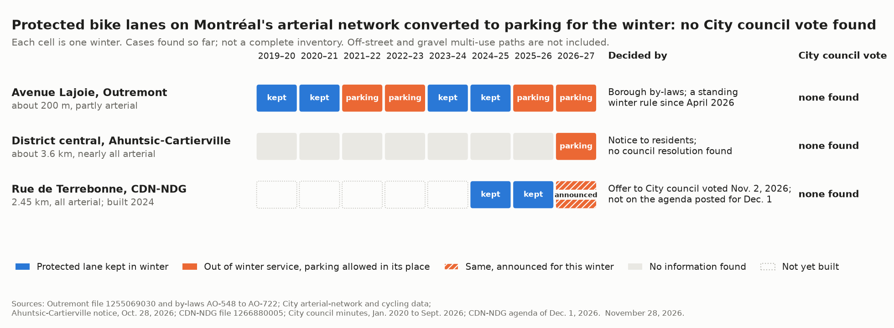

# Bike lanes on Montréal's arterial network and the powers of the boroughs: a map of the texts (winter changes of 2022 to 2026)

This folder gathers the by-laws, resolutions and council documents that bear on one question: when a borough changes a bike lane for the winter on a street of the City's arterial network, which council holds the power, and by what act is the change made? It is a **map of documents**: it describes and quotes, states the questions the texts raise, and where the texts allow two readings it gives both. It draws no conclusion. **It is not a legal opinion**, and its author is not a lawyer.

## Provenance

**Issued by:** Ville de Montréal (City council, agglomeration council, by-law register) and the boroughs of Côte-des-Neiges–Notre-Dame-de-Grâce, Ahuntsic-Cartierville and Outremont.
**Obtained:** November 16 to 28, 2026, from the City's by-law register ([montreal.ca/reglements-municipaux](https://montreal.ca/reglements-municipaux); a file name ending in a 24-character identifier is the register's own document, served at `api.montreal.ca/api/legal-affairs/legislation/publishing/v1/documentsContent/<identifier>`) and from the City's council archive (`ville.montreal.qc.ca/documents/Adi_Public/<council>/<file>`). Excerpts are cut page for page (qpdf); the page numbers in their names are those of the source file. Administrative codifications carry the City's own warning that they have no official value. Links working on the dates obtained.
**Elsewhere in this repository** (linked, not copied): [the 2024 approvals for rue de Terrebonne](../2024-project-approval/README.md), [the borough sitting of November 2, 2026](../2026-11-02-borough-council/README.md), [the agenda posted for December 1, 2026](../2026-12-01-borough-council/README.md), [the City council agenda of November 16, 2026](../2026-11-16-city-council-agenda/README.md), [that sitting](../2026-11-16-city-council/README.md), [the Ahuntsic-Cartierville notice of October 28, 2026](../2026-10-28-ahuntsic-district-central-winter-closure/README.md).

## The three cases

| | Avenue Lajoie, Outremont | District central, Ahuntsic-Cartierville | Rue de Terrebonne, Côte-des-Neiges–Notre-Dame-de-Grâce |
|---|---|---|---|
| The change | A bike lane of about 200 m becomes a shared lane with curb parking | Protected lanes on five streets closed and not cleared, parking in their place | One direction of a protected lane (2.45 km) to become parking; cyclists in that direction share the traffic lane |
| Winters | 2022, 2022–23, 2025–26; a standing rule from December 1 to March 31 since April 2026 | November 16, 2026 to March 31, 2027 | « December to March », as spoken; no date in a borough document |
| Instrument found | Borough by-laws amending the parking annex of by-law 1171: [AO-548](https://openmobilitydata.github.io/Terrebonne-open-sources/2026-arterial-network-delegation-texts/raw/outremont/AO-548.pdf), [AO-584](https://openmobilitydata.github.io/Terrebonne-open-sources/2026-arterial-network-delegation-texts/raw/outremont/AO-584.pdf), [AO-703](https://openmobilitydata.github.io/Terrebonne-open-sources/2026-arterial-network-delegation-texts/raw/outremont/AO-703_Reglement_1171_Annexe_H_voie_cyclable_Lajoie_1255069030.pdf), [AO-722](https://openmobilitydata.github.io/Terrebonne-open-sources/2026-arterial-network-delegation-texts/raw/outremont/AO-722.pdf) | None published: a notice to residents of October 28, 2026; no resolution or ordinance in the agendas and minutes of September 14, October 6, October 26 and November 9, 2026, and none in the by-law register amending the 2024 ordinance | An offer to City council under art. 85 of the Charter, voted 3–2 on November 2, 2026 (CA26 170231); no acceptance found; no item on the agenda posted for December 1, 2026 |
| How the lanes were established | By the borough, 2019 | Offer under art. 85, City council's acceptance (CM24 0740), borough ordinance [OCA24 058](https://openmobilitydata.github.io/Terrebonne-open-sources/2026-arterial-network-delegation-texts/raw/ahuntsic-cartierville/OCA24-058_BY_LAW_TEXT_66e9d3c729f1c89b015bb300.pdf) (2024) | Offer under art. 85, City council's acceptance (CM24 0179), borough ordinance [OCA24 17042](https://openmobilitydata.github.io/Terrebonne-open-sources/2026-arterial-network-delegation-texts/raw/cdn-ndg/OCA24-17042_BY_LAW_TEXT_666846d4201c35efa556552d.pdf) (2024) |

## The questions, and the texts that bear on each

### 1. Are the streets on the arterial network?

By-law 02-003, art. 1: « Le conseil de la Ville est responsable des rues et des routes qui appartiennent à la Ville de Montréal et qui forment le réseau artériel de la ville tel qu'il est identifié par une ligne orange continue dans le plan joint à l'annexe 1 »; art. 2: all other streets « sont de la responsabilité des conseils d'arrondissements » ([p. 1](https://openmobilitydata.github.io/Terrebonne-open-sources/2026-arterial-network-delegation-texts/raw/city/02-003_codifie_2026-10-27_excerpt_pp1-2_41.pdf#page=1); sheet 39 of the 2026 plan, which covers rue de Terrebonne, is [the third page of the excerpt](https://openmobilitydata.github.io/Terrebonne-open-sources/2026-arterial-network-delegation-texts/raw/city/02-003_codifie_2026-10-27_excerpt_pp1-2_41.pdf#page=3)). The City also publishes the network as open data, by street segment. [`derived/arterial_check.csv`](derived/arterial_check.csv), built by [`derived/arterial_check.py`](derived/arterial_check.py), joins that layer (2023 version) with the City's cycling network of October 14, 2026:

| Street | Borough | Facility type | In the protected four-season network | Facilities | Metres on arterial segments | Metres on other segments |
|---|---|---|---|---:|---:|---:|
| rue de Terrebonne | Côte-des-Neiges-Notre-Dame-de-Grâce | Bande cyclable | Non | 3 | 121 | 0 |
| rue de Terrebonne | Côte-des-Neiges-Notre-Dame-de-Grâce | Piste cyclable sur rue | Oui | 29 | 2413 | 0 |
| avenue du Parc | Ahuntsic-Cartierville | Piste cyclable sur rue | Oui | 4 | 753 | 0 |
| rue Meilleur | Ahuntsic-Cartierville | Bande cyclable | Non | 3 | 528 | 0 |
| rue Meilleur | Ahuntsic-Cartierville | Piste cyclable sur rue | Oui | 5 | 518 | 0 |
| rue de Port-Royal | Ahuntsic-Cartierville | Bande cyclable | Non | 4 | 0 | 290 |
| rue de Port-Royal | Ahuntsic-Cartierville | Chaussée désignée | Non | 1 | 0 | 81 |
| rue de Port-Royal | Ahuntsic-Cartierville | Piste cyclable sur rue | Non | 1 | 0 | 72 |
| rue de Port-Royal | Ahuntsic-Cartierville | Piste cyclable sur rue | Oui | 3 | 308 | 0 |
| rue Tolhurst | Ahuntsic-Cartierville | Bande cyclable | Non | 5 | 801 | 260 |
| rue Tolhurst | Ahuntsic-Cartierville | Piste cyclable sur rue | Oui | 4 | 257 | 404 |
| rue Legendre | Ahuntsic-Cartierville | Chaussée désignée | Non | 4 | 0 | 395 |
| rue Legendre | Ahuntsic-Cartierville | Piste cyclable sur rue | Oui | 14 | 1345 | 0 |
| rue Chabanel | Ahuntsic-Cartierville | Piste cyclable sur rue | Oui | 2 | 178 | 0 |
| avenue Lajoie | Outremont | Chaussée désignée | Non | 4 | 295 | 92 |

Limits: the open-data layer is the 2023 version and by-law 02-003 was amended on October 19, 2026; rue de Terrebonne was compared by eye with the 2026 plan, the other streets were not; no decision file read states the arterial status of any of these streets in words.

### 2. Which council holds the powers on the arterial network, and what is delegated to the boroughs?

The Charter of Ville de Montréal ([C-11.4, LégisQuébec](https://www.legisquebec.gouv.qc.ca/fr/document/lc/C-11.4)) gives City council the powers over roads, signage, traffic and parking on the arterial network (art. 105) and the boroughs those over their own streets (art. 142). City by-law 08-055 then delegates part of them back. Art. 2 delegates to each borough council the maintenance activities listed in annex A and, in its second paragraph, the adoption and application of traffic and parking regulation on the arterial network, with exceptions; the fifth: « l'établissement de voies de circulation réservées à l'usage exclusif des bicyclettes, de certaines catégories de véhicules routiers ou des seuls véhicules routiers qui transportent le nombre de personnes indiqué par une signalisation appropriée ainsi que tout pouvoir nécessaire afin d'assurer la mise en place et la fonctionnalité de telles voies » ([p. 2](https://openmobilitydata.github.io/Terrebonne-open-sources/2026-arterial-network-delegation-texts/raw/city/08-055_codifie_2024-12-20.pdf#page=2)).

Art. 4.5 (added by by-law 08-055-8): « Les pouvoirs délégués en vertu du deuxième alinéa de l'article 2 quant à l'adoption et l'application de la réglementation relative au contrôle de la circulation et du stationnement ne peuvent s'exercer sur une voie de circulation réservée à l'usage exclusif des bicyclettes, de certaines catégories de véhicules routiers ou des seuls véhicules routiers qui transportent le nombre de personnes indiqué par une signalisation appropriée s'ils ont pour effet de nuire ou d'empêcher toute fonctionnalité d'une telle voie » ([p. 4](https://openmobilitydata.github.io/Terrebonne-open-sources/2026-arterial-network-delegation-texts/raw/city/08-055_codifie_2024-12-20.pdf#page=4)).

Art. 4, paragraph 1.1, makes snow removal under the delegation subject to the City's policy: « en ce qui concerne le déneigement, réaliser l'ensemble des activités conformément à la Politique de déneigement dans le contexte des changements climatiques jointe au présent règlement à l'annexe C » ([p. 3](https://openmobilitydata.github.io/Terrebonne-open-sources/2026-arterial-network-delegation-texts/raw/city/08-055_codifie_2024-12-20.pdf#page=3)).

### 3. Is a protected bike lane a « voie de circulation réservée à l'usage exclusif des bicyclettes »?

The by-law's articles do not define the expression. Two readings are open on the texts.

- **Texts that point to yes.** Arts. 2 and 4.5 name bicycles expressly (« à l'usage exclusif des bicyclettes »). The boroughs' traffic by-law, as amended in 2023 in at least two boroughs, forbids stopping in such a lane in the same vocabulary: « nul ne peut immobiliser un véhicule routier dans une voie réservée aux bicyclettes » (C-4.1, art. 26, [p. 8](https://openmobilitydata.github.io/Terrebonne-open-sources/2026-arterial-network-delegation-texts/raw/cdn-ndg/C-4.1_CDN-NDG-codification_OFFICE_CONSOLIDATION_648c9bf7cdfd4591daa58e97.pdf#page=8); amending by-laws [RCA23 17383](https://openmobilitydata.github.io/Terrebonne-open-sources/2026-arterial-network-delegation-texts/raw/cdn-ndg/RCA23-17383_BY_LAW_TEXT_643ffa3753a13fa9839855f3.pdf) and [RCA23 09001](https://openmobilitydata.github.io/Terrebonne-open-sources/2026-arterial-network-delegation-texts/raw/ahuntsic-cartierville/RCA23-09001_BY_LAW_TEXT_643ff3fe53a13f464c98532c.pdf)).
- **Texts that point to no.** Annex C of by-law 08-055 (the snow-removal policy) has its own terminology: it defines « Voie réservée » as « Voie de circulation routière réservée aux véhicules pour le transport collectif (autobus, taxi, covoiturage) » and « Piste cyclable » separately, as « Espace dédié à la circulation des cyclistes ou des piétons. Les pistes cyclables situées sur la chaussée sont délimitées par un élément physique tel qu'un mail en béton, des bollards ou des véhicules stationnés » ([pp. 31–32](https://openmobilitydata.github.io/Terrebonne-open-sources/2026-arterial-network-delegation-texts/raw/city/08-055_codifie_2024-12-20.pdf#page=31)). In the City council minutes read (January 2020 to September 2026), the lanes created, changed or removed by City council resolution under these provisions were bus, taxi and shared bus-bicycle lanes; bike lanes came to City council as borough offers under art. 85.

No document read says which reading the City applies. The decision file of by-law 08-055-8 was not obtained.

### 4. The offer under art. 85 of the Charter, and City council's acceptance

Under art. 85, second paragraph, a borough council may offer to provide a service related to a competence of City council; the offer takes effect « à compter de l'adoption par le conseil de la ville d'une résolution acceptant la fourniture de services ». The lanes on rue de Terrebonne and in Ahuntsic-Cartierville were established that way in 2024 (see the table above and [the 2024 approvals](../2024-project-approval/README.md)). The borough's file of November 2, 2026 for the winter change schedules: « Novembre 2026: Le CM devra accepter l'offre du CA (via une résolution) » ([file 1266880005](../2026-11-02-borough-council/README.md)).

Two City council resolutions accept such offers in advance, for road works:

- CM16 1452 (December 19, 2016, unanimous): « d'accepter les offres de service à venir des conseils d'arrondissement afin de prendre en charge la réalisation de travaux de voirie dans des rues du réseau artériel administratif de la Ville, en vertu de l'article 85 de la Charte de la Ville de Montréal » ([minutes, p. 75](https://openmobilitydata.github.io/Terrebonne-open-sources/2026-arterial-network-delegation-texts/raw/city/CM_PV_2016-12-19_excerpt_p75_CM16-1452.pdf)).
- CM18 1378 (November 19, 2018, unanimous): the same acceptance « pour une période de trois ans (2019-2021) » ([minutes, p. 58](https://openmobilitydata.github.io/Terrebonne-open-sources/2026-arterial-network-delegation-texts/raw/city/CM_PV_2018-11-19_excerpt_p58_CM18-1378.pdf)).

The file of November 2, 2026 describes the winter change as work that « ne nécessiteraient aucune intervention de voirie ». No document read says whether either resolution is relied on for it, and no later resolution of the same kind was found.

### 5. The cycling network as a competence of the agglomeration

The borough files of 2024 and of November 2, 2026 are headed « Compétence d'agglomération : Réseau cyclable identifié au Plan de transport ». The agglomeration council delegates that competence to City council year by year; for 2026, resolution CG25 0718 (December 18, 2025) maintains the delegation to December 31, 2026 ([minutes, pp. 23–24](https://openmobilitydata.github.io/Terrebonne-open-sources/2026-arterial-network-delegation-texts/raw/city/CG_PV_2025-12-18_excerpt_pp23-24_CG25-0718.pdf)). No document read shows rue de Terrebonne on a map or list of the network identified in the Plan de transport, or says whether a change limited to marking and signage is a « réaménagement » of it.

### 6. By what act does a borough establish, or end, a bike lane?

The traffic by-law as it applies in Côte-des-Neiges–Notre-Dame-de-Grâce (C-4.1, administrative codification of April 12, 2023): by ordinance, the council may « établir […] des voies cyclables » (art. 3, [p. 3](https://openmobilitydata.github.io/Terrebonne-open-sources/2026-arterial-network-delegation-texts/raw/cdn-ndg/C-4.1_CDN-NDG-codification_OFFICE_CONSOLIDATION_648c9bf7cdfd4591daa58e97.pdf#page=3)); by resolution, « désigner les endroits et déterminer les périodes où le stationnement doit être interdit ou restreint à certaines fins par la signalisation » (art. 4, [p. 4](https://openmobilitydata.github.io/Terrebonne-open-sources/2026-arterial-network-delegation-texts/raw/cdn-ndg/C-4.1_CDN-NDG-codification_OFFICE_CONSOLIDATION_648c9bf7cdfd4591daa58e97.pdf#page=4)); and art. 26 forbids stopping in a lane reserved for bicycles ([p. 8](https://openmobilitydata.github.io/Terrebonne-open-sources/2026-arterial-network-delegation-texts/raw/cdn-ndg/C-4.1_CDN-NDG-codification_OFFICE_CONSOLIDATION_648c9bf7cdfd4591daa58e97.pdf#page=8)).

- **Côte-des-Neiges–Notre-Dame-de-Grâce.** Ordinance [OCA24 17042](https://openmobilitydata.github.io/Terrebonne-open-sources/2026-arterial-network-delegation-texts/raw/cdn-ndg/OCA24-17042_BY_LAW_TEXT_666846d4201c35efa556552d.pdf) (June 3, 2024) enacts the one-way on rue de Terrebonne « en vue d'ajouter un aménagement cyclable protégé »; its text enacts no bike lane. An ordinance of 2022 for another street, [OCA22 17047](https://openmobilitydata.github.io/Terrebonne-open-sources/2026-arterial-network-delegation-texts/raw/cdn-ndg/OCA22-17047_BY_LAW_TEXT_6352aed70bf60f29bf5f4bf1.pdf), is in the folder for comparison. The delegation by-law RCA04 17044 delegates to an official the powers of art. 4, not those of art. 3: « Les pouvoirs en matière de circulation et de stationnement prévus à l'article 4 du Règlement sur la circulation et le stationnement (R.R.V.M., c. C-4.1) sont délégués au directeur des travaux publics » (art. 17.3, [p. 8](https://openmobilitydata.github.io/Terrebonne-open-sources/2026-arterial-network-delegation-texts/raw/cdn-ndg/RCA04-17044_codification_OFFICE_CONSOLIDATION_675c3d077af99e27bfcac6d6.pdf#page=8)); « Un pouvoir délégué en vertu du présent règlement doit être exercé conformément aux dispositions de la loi et des règlements applicables » (art. 4, [p. 2](https://openmobilitydata.github.io/Terrebonne-open-sources/2026-arterial-network-delegation-texts/raw/cdn-ndg/RCA04-17044_codification_OFFICE_CONSOLIDATION_675c3d077af99e27bfcac6d6.pdf#page=2)). On November 4, 2024 a motion that the borough « retire temporairement la piste cyclable sur la rue de Terrebonne durant l'hiver 2024-2025 » was put to the council and rejected (CA24 170260, [minutes, pp. 22–23](https://openmobilitydata.github.io/Terrebonne-open-sources/2026-arterial-network-delegation-texts/raw/cdn-ndg/CA_Cdn_PV_2024-11-04_excerpt_pp22-23_CA24-170260.pdf)).
- **Ahuntsic-Cartierville.** Ordinance [OCA24 058](https://openmobilitydata.github.io/Terrebonne-open-sources/2026-arterial-network-delegation-texts/raw/ahuntsic-cartierville/OCA24-058_BY_LAW_TEXT_66e9d3c729f1c89b015bb300.pdf) (September 9, 2024), under art. 3, paragraph 1, establishes the lanes street by street (« aménager deux pistes cyclables unidirectionnelles »). Its delegation by-law RCA05 09017 delegates to officials listed powers of art. 4 (art. 26.1, [p. 7](https://openmobilitydata.github.io/Terrebonne-open-sources/2026-arterial-network-delegation-texts/raw/ahuntsic-cartierville/RCA05-09017_codification_2020-04-22.pdf#page=7)).
- **Outremont.** The winter rule on avenue Lajoie is written into the parking annex of the borough's traffic by-law 1171 ([codification of November 2026](https://openmobilitydata.github.io/Terrebonne-open-sources/2026-arterial-network-delegation-texts/raw/outremont/R-1171_codification_202611.pdf)) by the four by-laws listed in the table. The decision files for them are in the borough's agenda bundles in the City's council archive and are not reproduced here.

### 7. What each administration has said about its legal basis

No document read states the legal basis of any of the three winter changes. Neither by-law 08-055 nor the arterial network is mentioned in the Côte-des-Neiges–Notre-Dame-de-Grâce file of November 2, 2026 as a ground. The one public statement found is in [the City council sitting of November 16, 2026](../2026-11-16-city-council/README.md) (a machine-draft transcript; one passage checked by ear).

## Files

| File | Pages | What it is |
|---|---:|---|
| `raw/city/08-055_codifie_2024-12-20.pdf` | 42 | City by-law 08-055 (delegation to the boroughs of powers on the arterial network), administrative codification of December 20, 2024, with annexes A to C |
| `raw/city/02-003_codifie_2026-10-27_excerpt_pp1-2_41.pdf` | 3 | City by-law 02-003 (arterial and local networks), administrative codification of October 27, 2026: the articles and sheet 39 of the plan (the full file, 58 pages, is not reproduced) |
| `raw/city/CM_PV_2016-12-19_excerpt_p75_CM16-1452.pdf`, `raw/city/CM_PV_2018-11-19_excerpt_p58_CM18-1378.pdf` | 1, 1 | City council minutes: resolutions CM16 1452 and CM18 1378 |
| `raw/city/CG_PV_2025-12-18_excerpt_pp23-24_CG25-0718.pdf` | 2 | Agglomeration council minutes: resolution CG25 0718 |
| `raw/cdn-ndg/C-4.1_…pdf`, `raw/cdn-ndg/RCA23-17383_…pdf` | 26, 1 | Traffic and parking by-law as codified for the borough (April 12, 2023), and the 2023 amendment of art. 26 |
| `raw/cdn-ndg/RCA04-17044_…pdf` | 13 | The borough's by-law delegating powers to officials, administrative codification of December 5, 2024 |
| `raw/cdn-ndg/OCA24-17042_…pdf`, `raw/cdn-ndg/OCA22-17047_…pdf` | 1, 2 | Ordinances of 2024 (rue de Terrebonne) and of 2022 (another street) |
| `raw/cdn-ndg/CA_Cdn_PV_2024-11-04_excerpt_pp22-23_CA24-170260.pdf` | 2 | Borough council minutes of November 4, 2024: the motion on a temporary winter removal |
| `raw/ahuntsic-cartierville/OCA24-058_…pdf`, `RCA05-09017_…pdf`, `RCA23-09001_…pdf` | 1, 7, 1 | The 2024 ordinance establishing the lanes; the delegation by-law (codification of April 22, 2020); the 2023 amendment of art. 26 |
| `raw/outremont/AO-548.pdf`, `AO-584.pdf`, `AO-703_…pdf`, `AO-722.pdf` | 1, 1, 3, 2 | The four by-laws on avenue Lajoie's winter rule (AO-703 and AO-722 are image files without a text layer) |
| `raw/outremont/R-1171_codification_202611.pdf` | 199 | Outremont's traffic by-law 1171, codification of November 2026 |
| `derived/arterial_check.py`, `derived/arterial_check.csv` | | The check of each street against the arterial layer |
| `derived/figures/winter-removals-timeline/` | | The figure above, English and French, with its script |
| `derived/dependencies.csv`, `derived/check_folder.py` | | What each dated statement rests on and when to check it again; the script that checks the folder |

## Keeping this folder current

Several statements above describe a state of the record on a date (« no acceptance found », « no item on the agenda posted », « none published »). Each is listed in [`derived/dependencies.csv`](derived/dependencies.csv) with the folder or public source it rests on, the date it was last checked and the event that calls for a new check. [`derived/check_folder.py`](derived/check_folder.py) verifies that every link of this README resolves, that every page reference exists, that every file under `raw/` is linked, that the table of streets matches its source, and that no folder this one depends on has changed since the statement was last checked; it is run before each commit that touches this folder or one of those folders. Last full check: November 28, 2026.

## What this folder does not establish

- Whether art. 4.5 of by-law 08-055 applies to a protected bike lane, and so whether it limits any of the three changes.
- By what act the Ahuntsic-Cartierville closure was decided, and by what act the change on rue de Terrebonne would be made.
- Whether City council's acceptance is required for the change on rue de Terrebonne, or whether an earlier resolution is relied on.
- That the inventory of cases is complete: these are the cases found so far.
- The official texts: by-laws 08-055 and 02-003 are read here in administrative codifications.

## Evidence graph

`d_bylaw_08_055`, `d_bylaw_02_003`, `d_cm16_1452`, `d_arterial_texts` in [`2026-evidence-graph/`](../2026-evidence-graph/).
