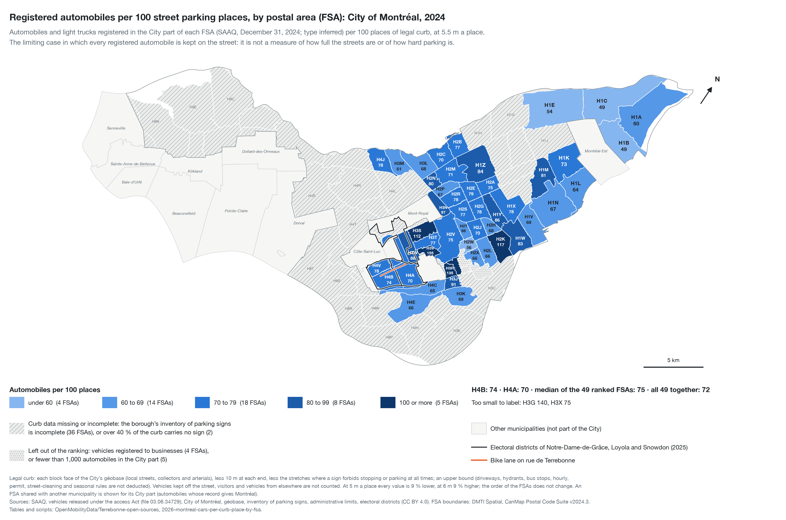
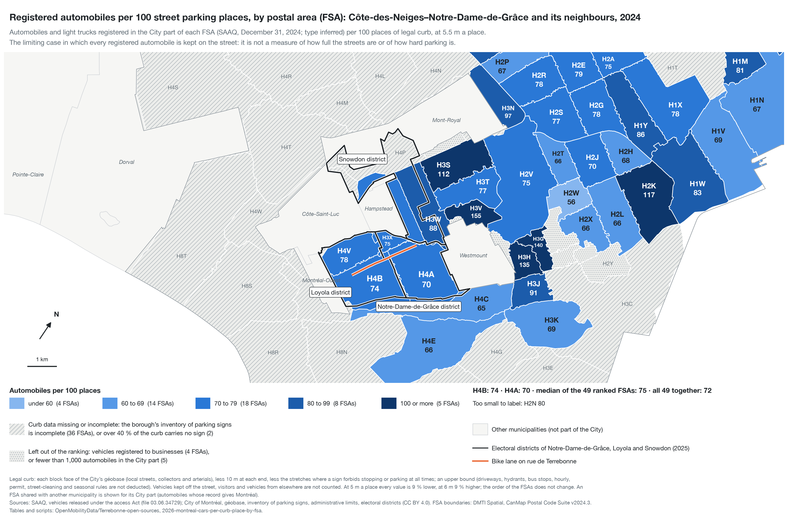
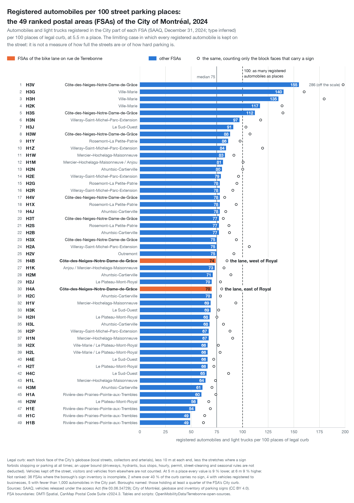

# Registered automobiles per street parking place, by postal area (FSA), City of Montréal, 2024 (maps, ranking, tables) — draft

**Issued by:** the author of these repositories (see the root README). **Status: draft** (built November 14, 2026; under the author's review).

**Sources.** SAAQ, vehicle file released under the access Act for December 31, 2024 (file 03.06.34729), by forward sortation area (FSA) and municipality, as tabulated in [`Quebec-vehicle-registrations`](https://github.com/OpenMobilityData/Quebec-vehicle-registrations/blob/main/README.md) (`derived/tables/type_by_fsa_municipality.csv`; **vehicle type inferred**). City of Montréal open data (CC BY 4.0): géobase (downloaded October 14, 2026; its table of street classes read on the [dataset page](https://donnees.montreal.ca/dataset/geobase) on November 14, 2026), « Signalisation – stationnement » (the inventory of parking signs, October 23, 2026), administrative limits of the agglomeration, electoral districts of 2025. FSA polygons: DMTI Spatial, CanMap Postal Code Suite v2024.3, under licence: drawn on the maps, not redistributed. The curb method is the one of [`2026-terrebonne-corridor-vehicles-and-curb`](../2026-terrebonne-corridor-vehicles-and-curb/) (`scripts/curb_supply.py`), applied to the whole City.

**Date:** analysis of November 14, 2026.

**Question.** How many automobiles and light trucks are registered in each postal area of the City for each place of legal curb it holds, and where do the two postal areas of the rue de Terrebonne bike lane stand (the lane lies in H4B west of Royal and in H4A east of it)?

**What the ratio is, and is not.** It is the limiting case in which every registered automobile is kept on the street. It is not a measure of how full the streets are or of how hard parking is: vehicles kept off the street (garages, driveways, lots) are in the numerator; visitors, commercial traffic and vehicles registered elsewhere are not; and the curb is an upper bound (hourly rules, permit zones, street-cleaning and seasonal rules, driveways, hydrants and bus stops are not deducted). No private parking, imagery or LiDAR is used at this scale.

| File | Content |
|---|---|
| [`derived/tables/fsa_ratio.csv`](derived/tables/fsa_ratio.csv) | One row per FSA with curb in the City (96): status (ranked, or the reason it is not), rank, automobiles registered in the City part, legal curb, places at 5.5 m, automobiles per place (and per 100 places, the figure printed on the maps), the same at 5 m and 6 m, per 100 m of legal curb, the same ratio counted on signed block faces only with its rank, the share of the FSA's City curb in boroughs with a complete sign inventory, the share of its curb and of its automobiles that are in the City, the boroughs it lies in |
| [`derived/tables/curb_by_fsa.csv`](derived/tables/curb_by_fsa.csv), [`curb_by_fsa_borough.csv`](derived/tables/curb_by_fsa_borough.csv) | Curb by FSA, and by FSA and borough or municipality: length, length net of 10 m at each end, length forbidden at all times, legal curb, poles; no reading where the inventory is incomplete or absent |
| [`derived/tables/curb_by_borough.csv`](derived/tables/curb_by_borough.csv) | The 19 boroughs: curb, poles per km, whether the inventory is taken as complete, the share forbidden at all times, the share of the curb on block faces without any sign (local streets; collectors and arterials) |
| [`derived/tables/check_against_corridor.csv`](derived/tables/check_against_corridor.csv) | The 1,523 block faces of the corridor analysis recomputed here: same legal curb on every face |
| [`derived/numbers.json`](derived/numbers.json) | The numbers quoted below |
| [`derived/figures/fsa-ratio-map/`](derived/figures/fsa-ratio-map/) | The map of the whole City and the same map enlarged on Côte-des-Neiges–Notre-Dame-de-Grâce and its neighbours (`_west`), PNG and SVG, English and French, with the script |
| [`derived/figures/fsa-ratio-ranking/`](derived/figures/fsa-ratio-ranking/) | The ranked FSAs as a bar chart, H4A and H4B marked, PNG and SVG, English and French, with the script |
| `scripts/` | `curb_by_fsa.py` (stage 1), `ratio.py` (stage 2), `ratio_lib.py` (paths and the constants of the rules), `fig_lib.py` |

## Method

- **Unit: the City part of each FSA.** An FSA can lie in several municipalities (H3X: Montréal, Hampstead and Côte-Saint-Luc; H4V: Montréal and Côte-Saint-Luc; H1B: Montréal and Montréal-Est). Automobiles are those whose record gives the municipality of Montréal; curb is that of the block faces whose side lies in the City. No count is moved below the FSA and none is moved onto electoral districts: the districts of Notre-Dame-de-Grâce, Loyola and Snowdon are outlined on the maps for reference only.
- **Automobiles.** Automobiles and light trucks (the SAAQ's type « AU »), personal and commercial together, December 31, 2024. The release gives make, model, model year, municipality and FSA only; the type is inferred from the published years (Quebec-vehicle-registrations: on years where the truth is published, Montréal's automobiles are inferred within 0.05 to 0.13 %; no published count exists by FSA to test against).
- **Legal curb.** Each block face of the géobase (one side of one street segment): its length, less 10 m at each end (5 m for the cross street's half roadway, an assumption, and the 5 m next to an intersection where the Highway Safety Code forbids stopping, art. 386, par. 4), less the stretches where a sign forbids stopping or parking at all times (« \A EN TOUT TEMPS », « \P EN TOUT TEMPS »); arrows read as in the corridor analysis. A block face without any sign counts as legal curb.
- **Streets counted.** The géobase's classes 0, 5, 6 and 7, which its dataset page lists as « Rues locales », « Collectrices », « Artères secondaires » and « Artères principales ». Left out: classes 1 (« Certaines voies piétonnières »), 2 (« Places d'affaires »), 3 (« Quai »), 4 (« Privée »: among them the port's roads, park and railway roads, the Circuit Gilles-Villeneuve), 8 (« Autoroutes ») and 9 (« Rue projetée »), 245 km of curb in the City; and by street type autoroutes, bridges, tunnels, ramps and back lanes. The corridor analysis left out by street type only; its two FSAs hold two faces of the classes left out here (0.9 km).
- **Boroughs with a complete sign inventory.** Eight poles or more per km of curb: eleven boroughs (Ahuntsic-Cartierville, Anjou, Côte-des-Neiges–Notre-Dame-de-Grâce, Le Plateau-Mont-Royal, Le Sud-Ouest, Mercier–Hochelaga-Maisonneuve, Outremont, Rivière-des-Prairies–Pointe-aux-Trembles, Rosemont–La Petite-Patrie, Ville-Marie, Villeray–Saint-Michel–Parc-Extension: 11.0 to 26.0 poles per km). The other eight (L'Île-Bizard–Sainte-Geneviève, Lachine, LaSalle, Montréal-Nord, Pierrefonds-Roxboro, Saint-Laurent, Saint-Léonard, Verdun) have 0.0 to 2.8; there, 79 to 100 % of the local-street curb lies on block faces without any sign, against 3 to 26 % in the eleven.
- **Which FSAs are ranked** (the author's rules of November 14, 2026; constants in `scripts/ratio_lib.py`). An FSA is ranked when (a) at least 90 % of its City curb lies in the eleven boroughs (the remainder then takes the share forbidden at all times measured in the FSA's complete part: 6.3 % of the City curb of H4E, 1.4 % for H4J, under 1 % for four others); (b) its City part holds at least 1,000 registered automobiles; (c) it is not one of the FSAs whose registered count exceeds 1.5 times what their census profile predicts, a sign of vehicles registered to businesses (corridor analysis, `lofo_errors.csv`: H2Y, H2Z, H3A, H3B, H4P, H9P); (d) no more than 40 % of its curb, net of ends, lies on block faces without any sign (H3C: parc Jean-Drapeau and Cité du Havre; H1J: Anjou's industrial sector and autoroute service roads; there the ratio depends on whether such faces hold places: 67 or 223 per 100 places for H3C, 45 or 88 for H1J).
- **Places.** Legal curb at 5.5 m a place (an assumption, as in the corridor note). At 5 m every value is 9 % lower, at 6 m 9 % higher; the order of the FSAs is the same.
- **Sensitivity.** For every FSA the table also gives the ratio counted on the block faces that carry at least one sign (less curb, a higher value); the two readings bracket what the inventory can say about faces without a sign.
- **Check.** The 1,523 block faces of the corridor analysis, recomputed from the City-wide files, give the same legal curb on every face (146.417 km both ways; largest difference 0.05 m).

## Results (draft)

- Of the 96 FSAs with curb in the City, **49 are ranked**. They hold 411,548 of the 754,747 automobiles and light trucks registered in Montréal with an FSA beginning with H (54.5 %), and 3,139 km of legal curb (570,717 places at 5.5 m). Not ranked: 36 where the sign inventory is incomplete, 2 where over 40 % of the curb carries no sign, 4 with vehicles registered to businesses, 5 with fewer than 1,000 automobiles in the City part.
- Automobiles per 100 places, the 49 ranked FSAs: from 49 (H1B, H1C, Rivière-des-Prairies–Pointe-aux-Trembles) to 155 (H3V, Côte-des-Neiges); **median 75**; the 49 taken together, 72. Five FSAs are at 100 or more (H3V 155, H3G 140, H3H 135, H2K 117, H3S 112).
- **H4B: 74 per 100 places, 26th of 49** (7,331 automobiles; 54.2 km of legal curb; 9,852 places). **H4A: 70, 30th of 49** (9,579 automobiles; 75.5 km; 13,731 places). At 5 m and 6 m a place: H4B 68 and 81, H4A 63 and 76.
- The other ranked FSAs lying mainly in Côte-des-Neiges–Notre-Dame-de-Grâce: H3V 155 (1st), H3S 112 (5th), H3W 88 (8th), H4V 78 (17th; City part, 76 % of the FSA's automobiles), H3T 77 (20th), H3X 75 (23rd; City part, 48 %).
- Counted on signed block faces only: median 87; H4B 85 (28th), H4A 80 (34th); the two rankings of the 49 FSAs have a rank correlation of 0.90.

## Limits

- The ratio compares registered vehicles with an upper bound on curb places; it says nothing of occupancy, which has not been counted.
- The type of each 2024 vehicle is inferred; personal and commercial vehicles cannot be told apart in the release.
- A vehicle is located by the FSA and municipality of its record; FSA polygons are DMTI Spatial's, and each block face takes the FSA of the polygon at its side of the street.
- Where a block face carries no sign, the inventory cannot say whether places exist (a residential street without restrictions, or a park road); rule (d) and the signed-faces reading address this in part.
- Thirty-six FSAs of the City, all or mostly in the eight boroughs whose inventory is incomplete, have no value.
