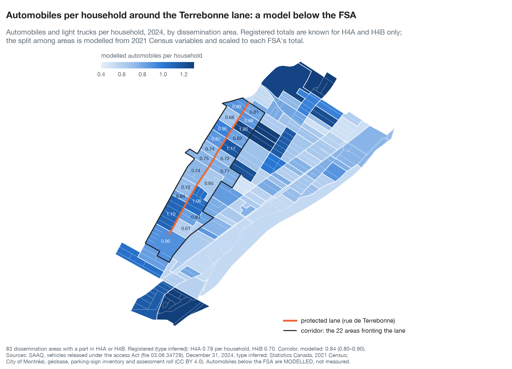

# Automobiles and curb along rue de Terrebonne: registered vehicles known by FSA, modelled below it; legal curb measured by block face (note, deck, data) — preliminary results, not peer reviewed

**Issued by:** the author of these repositories (see the root README). **Status: preliminary results, not peer reviewed** (reviewed by the author and promoted from draft on November 12, 2026; note and deck v2026-11-12-14-43-06).

**Sources.** SAAQ, vehicle files released under the access Act for December 31, 2023 and 2024 (file 03.06.34729), by forward sortation area (FSA), as tabulated in [`Quebec-vehicle-registrations`](https://github.com/OpenMobilityData/Quebec-vehicle-registrations/blob/main/README.md) (`derived/tables/type_by_fsa.csv`; **vehicle type inferred**). Statistics Canada, 2021 Census profile by FSA (98-401-X2021013) and by dissemination area, Québec (98-401-X2021006), and the dissemination-area boundary file (Statistics Canada Open Licence; downloaded November 2026). City of Montréal open data (CC BY 4.0): géobase (downloaded October 14, 2026), « Signalisation – stationnement » (sign inventory, October 23, 2026), « Unités d'évaluation foncière » (assessment roll, October 25, 2026). FSA polygons: DMTI Spatial, CanMap Postal Code Suite v2024.3, and postal-code points: Service Objects (March 2024), both under licence and not redistributed. The 2015 LiDAR night count, the garage and driveway readings and the street frame come from [`1954-underwriters-plans-terrebonne-garages`](../1954-underwriters-plans-terrebonne-garages/); EXP's parking counts from [`2026-parking-supply-demand-survey-context`](../2026-parking-supply-demand-survey-context/).

**Date:** analysis of November 11, 2026.

**Question.** The SAAQ release locates each vehicle to its FSA only; the lane lies in H4B west of Royal and in H4A east of it. What can be said about the dissemination areas that front the lane: how many automobiles are registered there, and how much legal curb do they hold?

**Two kinds of figures, kept apart throughout.** Curb is **measured**, block face by block face, from the sign inventory. Automobiles below the FSA are **modelled** from census variables and scaled so that the areas of each FSA sum to its registered total: within an FSA the split is an estimate with an interval, never a count. The 2015 LiDAR and the imagery are a check, not an input.

| File | Content |
|---|---|
| [`docs/corridor_vehicles_curb_note_en.pdf`](https://openmobilitydata.github.io/Terrebonne-open-sources/2026-terrebonne-corridor-vehicles-and-curb/docs/corridor_vehicles_curb_note_en.pdf) | The note (14 pp.): lay summary, overview map, question, data, method, the two tests of the model, results, private parking (the October 25 reading of rue de Terrebonne; every lot of the corridor read and a random sample checked from the street), the 2015 check, what is and is not shown, tables |
| [`docs/corridor_vehicles_curb_deck_en.pdf`](https://openmobilitydata.github.io/Terrebonne-open-sources/2026-terrebonne-corridor-vehicles-and-curb/docs/corridor_vehicles_curb_deck_en.pdf) | The slide deck (19 slides, 16:9); its figures as PNG files named by slide number in `docs/deck_figures_en/` |
| [`derived/lay_abstract_en.txt`](derived/lay_abstract_en.txt) | The lay summary (300 words), plain text |
| [`derived/numbers.json`](derived/numbers.json) | Every number the note quotes |
| [`derived/tables/da_corridor.csv`](derived/tables/da_corridor.csv), [`.geojson`](derived/tables/da_corridor.geojson) | The 83 dissemination areas with a part in H4A or H4B: households, modelled automobiles with 90 % intervals (and intervals with the unexplained spread doubled), the two alternative specifications, legal curb, places at 5.5 m, the set (corridor or rest), the frontage on Terrebonne |
| [`derived/tables/corridor_sets.csv`](derived/tables/corridor_sets.csv) | Totals for the corridor, the rest and all areas |
| [`derived/tables/block_faces.csv`](derived/tables/block_faces.csv), [`.geojson`](derived/tables/block_faces.geojson) | Every block face of those areas: length, length net of 10 m at each end, length forbidden at all times, legal curb, poles, dissemination area |
| [`derived/tables/curb_by_da.csv`](derived/tables/curb_by_da.csv), [`terrebonne_curb_by_block.csv`](derived/tables/terrebonne_curb_by_block.csv) | Curb by dissemination area; rue de Terrebonne by block and side (the check of the sign reading) |
| [`derived/tables/fsa_model_table.csv`](derived/tables/fsa_model_table.csv), [`da_census.csv`](derived/tables/da_census.csv), [`da_fsa_shares.csv`](derived/tables/da_fsa_shares.csv), [`fsa_households_check.csv`](derived/tables/fsa_households_check.csv) | The census variables by FSA (with the automobiles of 2023 and 2024, inferred) and by dissemination area (census divisions of Montréal and Laval); the share of each area in each FSA; households rebuilt from areas against Statistics Canada's FSA profile |
| [`derived/tables/model_specifications.csv`](derived/tables/model_specifications.csv), [`model_coefficients.csv`](derived/tables/model_coefficients.csv), [`lofo_errors.csv`](derived/tables/lofo_errors.csv), [`downscaling_test.csv`](derived/tables/downscaling_test.csv), [`downscaling_summary.csv`](derived/tables/downscaling_summary.csv), [`fsa_scale_factors.csv`](derived/tables/fsa_scale_factors.csv), [`da_vehicles.csv`](derived/tables/da_vehicles.csv) | The model: specifications compared, coefficients, each FSA left out in turn, the downscaling test, the scale factors, the estimates by area |
| [`derived/tables/lidar_check_by_sector.csv`](derived/tables/lidar_check_by_sector.csv), [`lidar_check_by_da.csv`](derived/tables/lidar_check_by_da.csv) | Cars seen along Terrebonne on the 2015 LiDAR night against the model |
| [`derived/tables/offstreet_terrebonne_by_sector.csv`](derived/tables/offstreet_terrebonne_by_sector.csv), [`offstreet_measured_by_da.csv`](derived/tables/offstreet_measured_by_da.csv), [`derived/offstreet.json`](derived/offstreet.json) | Private parking: the buildings read on rue de Terrebonne by sector (October 25 reading); the corridor's small buildings by dissemination area, measured (every lot read, calibrated on the owner's check) |
| [`derived/readings/`](derived/readings/README.md), [`derived/tables/offstreet_frame.csv`](derived/tables/offstreet_frame.csv), [`offstreet_crops.csv`](derived/tables/offstreet_crops.csv), [`offstreet_readings_v2.csv`](derived/tables/offstreet_readings_v2.csv), [`offstreet_owner_check.csv`](derived/tables/offstreet_owner_check.csv), [`offstreet_reading_checks_v2.csv`](derived/tables/offstreet_reading_checks_v2.csv) | The lot-by-lot reading: the frame (2,358 buildings), the protocols, each reader's file, the first pass that failed its checks (kept as a record), the second pass, the owner's check of 112 lots drawn at random, and the agreement tables |
| `derived/figures/<type>/` | `overview-map`, `curb-map`, `area-estimates`, `model-tests`, `curb-and-automobiles`, `off-street-terrebonne`, `off-street-corridor`, `lidar-check`, `corridor-parking-map` (Nov 12, 2026: every source on one map: areas shaded by modelled automobiles, legal curb by block face, Terrebonne's lots by their private places counted from street level, and a table per area of modelled automobiles, curb places and calibrated private places; no ratio of cars to places), `social-maps` (Nov 12, 2026: `then_and_now` = one block, Hingston to Hampton, on the 1954–55 plans beside the aerial image, with the street-check markers, a cross-check built from the 1954 folder's one-block figure; and the two maps in landscape for social media, larger type, the Loyola / NDG district line from the City's 2025 electoral districts, district shares in `district_shares.json`: Loyola 39 % with private places and 50 % curb alone, NDG 68 % and 94 %), `snow-loading-overflow` (Nov 12, 2026, owner's question: on an area's own loading night, central case, the share of its modelled automobiles that would not fit in its places, private places included, and the spare curb in the corridor areas touching it, on an ordinary night and if they are cleared the same night; independent of the order of loading; columns `overflow_*` and `adjacent_spare_*` in `snow_loading_areas.csv`), `snow-loading-illustration` (Nov 12, 2026: an explanatory ILLUSTRATION, kept here and not posted (owner: no invented sequence in a public post), labelled so on the image, of how a loading operation moves through the corridor; the nightly share of the curb under a ban is real, from the operation of January 17–22, 2026, the order of the streets is invented, a sweep west to east per sector, the second side of each street a night behind; `snow_loading_animation.py` makes the same illustration a 20-second video, night by night, `snow_loading_animation_{en,fr}.mp4`), `snow-loading-areas` and `snow-loading-districts` (Nov 12, 2026: modelled automobiles as a share of places on snow-loading nights, area by area under the three assumptions, and district by district night by night over five winters; see the section below), `status-map` (Nov 12, 2026: the status colours of the charts on a map, modelled automobiles as a share of places, green under 80 %, yellow 80 to 100 %, red over 100 %; A with private places, B curb alone; in A, the 11 areas where most households live in buildings of six dwellings or more, whose garages are not counted, are hatched; a share compares vehicles with capacity, not a measure of how full the street is): PNG and SVG, English and French, each with its script |
| `scripts/` | `build_dataset.py`, `curb_supply.py`, `demand_model.py`, `corridor.py`, `offstreet_strips.py`, `offstreet_crops.py`, `offstreet_check_page.py`, `terrebonne_street_check_page.py` (the owner's street-level check of every lot on Terrebonne, Nov 12, 2026), `offstreet_readings.py`, `offstreet_readings_v2.py`, `offstreet.py`, `build_docs.py [--final]`, `corridor_lib.py`, `fig_lib.py` |



## Method, in brief

- **Areas and FSAs.** Dissemination areas do not nest in FSAs; each is shared among FSAs in proportion to the roll's dwellings in each FSA polygon (households rebuilt this way: H4A -1.2 %, H4B -1.2 % against Statistics Canada's FSA profile).
- **Corridor.** The 22 dissemination areas that hold a block face of rue de Terrebonne along the lane; they reach about one block to each side.
- **Legal curb.** Length of each block face, less 10 m at each end (5 m for the cross street's half roadway, an assumption, and the 5 m next to an intersection where the Highway Safety Code forbids stopping, art. 386, par. 4), less the stretches where a sign forbids stopping or parking at all times; arrows read as described in `curb_supply.py`. An upper bound: driveways, hydrants, bus stops, hourly rules, permit zones and seasonal rules are not deducted. Checked on rue de Terrebonne, where the reading finds one parking band (south side west of Cavendish, north side east of it), 1,306 m, 238 places at 5.5 m.
- **Automobiles.** Robust regression of the logarithm of automobiles per household on four census variables across 114 FSAs; prediction for each area; scaling to each FSA's registered total; 2,000 draws for the intervals.
- **Tests** (at the level of FSAs, the only one with registered counts): each FSA left out in turn; neighbouring FSAs grouped by threes and the group's total shared among them.

## Results (preliminary)

- Registered, by FSA (type inferred): H4A 9,598 automobiles and light trucks, 0.79 per household; H4B 7,351, 0.70.
- Downscaling test: the model's share of a group's total is off by 4.6 % at the median; a split in proportion to households, by 13.9 %. For H4A and H4B taken as a pair the two are close (-4.6 % and +6.0 % against -5.5 % and +7.1 %).
- Corridor, **modelled**: 4,622 automobiles for 5,471 households (90 % interval 4,382 to 4,927), 0.84 per household (0.80 to 0.90); the other areas of the two FSAs, 0.76. A single area's interval is about a quarter of its estimate either way.
- Corridor, **measured**: 46.8 km of curb, 37.2 km legal; 6,192 to 7,431 places at 6 to 5 m (upper bound).
- 0.68 modelled automobile per place of legal curb at 5.5 m. This is the limiting case where every registered vehicle is kept at the curb; the note states why the ratio is not a measure of parking pressure in either direction.
- Private parking, **measured** on rue de Terrebonne (the author's street-level check of every lot on the street, November 12, 2026; [`../1954-underwriters-plans-terrebonne-garages/derived/street_check/`](../1954-underwriters-plans-terrebonne-garages/derived/street_check/README.md)): 129 of the 149 lots judged have car access today, at least one private place usable (87 %, 80 to 91); the buildings of five dwellings or fewer hold 165 independent places (266 with tandem) for 230 dwellings (206 modelled automobiles), beside 238 curb places on the street today; the 6 larger buildings (246 dwellings) get no places, 5 of them have an underground garage; parking turned to another use on 31 lots (12 with none left). Until November 12 this line gave 89 of 123 buildings with a garage as built or a driveway (72 %, one place each), from a reading of the aerial imagery that missed driveways.
- Private parking, **measured** for the corridor: every lot holding a dwelling (2,358) was read on enlarged aerial crops by independent readers, and a random sample of 112 lots drawn beforehand was judged by the author from street-level imagery. Of the 99 buildings of five dwellings or fewer judged yes or no, 85 have car access (86 %; where the readers said no, the check found access in 15 of 23). Calibrated on the check, the corridor's 2,262 small buildings have 2,228 private places a car can leave without another being moved (2,051 to 2,414; 90 % interval), 3,731 with cars one behind another; garage interiors not counted. With them, 0.51 modelled automobile per place. The 96 buildings of six dwellings or more (2,592 dwellings) are given none: 6 of the 12 checked have an underground garage whose places cannot be counted.
- 2015 LiDAR night: 436 cars seen at the curbs and on the lots along Terrebonne for 573 dwellings addressed on the street (0.76 per dwelling) against 0.84 modelled per household; the area-by-area comparison shows no relation (rank correlation 0.31, 11 areas).

## Snow-loading nights (November 12, 2026)

The owner asked how snow-loading bans change the picture. **What the City publishes** (open-data portal, checked November 12, 2026, CC BY 4.0): the truckloads hauled per snow-removal sector and per day (« Contrats et transactions de déneigement », daily table in [`Terrebonne-access-requests/2026-300/derived/loading_daily.csv`](https://github.com/OpenMobilityData/Terrebonne-access-requests/blob/main/2026-300/derived/loading_daily.csv)), the sector polygons for every season since 2016–17 (« Secteurs de déneigement »), and the lots open during loading (« Stationnements gratuits et payants (déneigement) »). **What it does not publish:** which street, or which side, was under a ban on which night. Info-Neige / Planif-Neige is a live API with a token; the portal holds no history of it. That part is replaced by assumptions (`scripts/snow_loading.py`, owner's choices of November 12):

- **Operation:** a run of loading days in a sector (one-day gaps allowed) of at least 100 truckloads, December 1 to March 31; smaller runs are spot removals, left out (50 and 200 as sensitivity). Each block face is under a ban one night per operation, at night.
- **Area scale:** cars stay in their area; on its loading nights 25 %, 50 % (central case) or 100 % of its curb is under a ban (four, two or one nights per operation).
- **District scale:** cars move anywhere in the district's part of the corridor; the night's share of its curb under a ban = the night's truckloads in the sector over the operation's total (at most 36 %).
- **Free lot:** one listed lot within 1.5 km, the Doug-Harvey arena (4985 West Hill, 20 places, 18:00–07:00), listed 2020–21 to 2023–24 and not since; added in the winters listed.

**Results (assumptions, not observations; capacity, not occupancy):** in the central case, private places included, 7 of the 22 areas have more modelled automobiles than places on their loading night; 2 of them (areas 6 and 15, mostly large buildings whose garages are not counted) are over on ordinary nights already, the other 5 on 6.8 nights a winter. Curb alone: 17 (6 already). At 25 %: 3; at 100 %: all 22. District scale: the Loyola part stays under 100 % every night of the five winters (curb alone at most 77 %); the NDG part stays under 100 % with private places (at most 92 %) and is over 100 % with the curb alone on 22, 22, 9, 9 and 28 nights (2021–22 to 2025–26). Files: `derived/snow_loading.json`, `derived/tables/snow_loading_operations.csv`, `snow_loading_areas.csv`, `snow_loading_area_nights.csv`, `snow_loading_district_nights.csv`, `snow_loading_districts.csv`; note section 4.7, deck slides 19–21. The sector polygons and lot lists are read from `~/Terrebonne-data/third-party/montreal-opendata/{secteurs-deneigement,stationnements-deneigement}/` (City open data, not redistributed here).

## Test: can the 2015 LiDAR find the curb cuts? (November 12, 2026)

The legal curb above is an upper bound because driveways and parking entrances are not deducted. Asked whether the City's 2015 airborne LiDAR could measure them (owner, Nov 12), a detector was tested on rue de Terrebonne against the author's street-level check of every lot (`scripts/curb_cuts_lidar.py`). The ground returns within 22 m of the lane (about 6 per m²) give the curb step every 0.5 m on each side: the median height 0.2–1.0 m behind the curb less that 0.2–1.0 m in front of it, at the curb line found for each 40 m stretch. The ordinary curb stands about 16 cm; 9 % of the stations have no data (a car or a tree hides the curb). A cut is a run of at least 2 m where the step, smoothed over 2.5 m, is at least 5 cm under the local curb and under 10 cm, away from intersections.

**Result: not good enough to replace the assumption.** Of the 82 lots whose car access is by a driveway or front pad on Terrebonne, the detector finds a cut in front of 47 (57 %); of the 7 lots with no car access, it flags 1. The driveway cuts on this street are lowered, not flush: the lowest smoothed step in front of a driveway lot has a median of about 7 cm, against about 15 cm in front of a lot without access, and the noise of the 2015 survey reaches that range on ordinary curb too. These figures are optimistic: the setting was chosen from the sweep of 60 settings on the same lots (`derived/tables/terrebonne_curb_cut_sweep.csv`; no setting found more than 51 of the 82 with fewer than one false alarm). Other limits: 2015 against 2026 (driveways made or removed since count against the detector); the 7 lots without access are too few to measure false alarms well. Where it does find a known driveway, the lowered curb is typically 4 m long (quartiles 2.5 to 6 m), consistent with the 4.5 m (central) and 6 m (least favourable) assumed in the detectable-shortage calculation, but drawn from partial detections. Files: `derived/tables/terrebonne_curb_cuts_lidar.csv` (the runs), `terrebonne_curb_cut_test_lots.csv` (lot by lot), `terrebonne_curb_cut_sweep.csv`, `derived/curb_cut_test.json`. The curb deduction therefore stays an assumption, stated as such.

## Reproduce

```
~/.venvs/omd/bin/python scripts/build_dataset.py
~/.venvs/omd/bin/python scripts/curb_supply.py
~/.venvs/omd/bin/python scripts/demand_model.py --draws=2000
~/.venvs/omd/bin/python scripts/corridor.py
~/.venvs/omd/bin/python scripts/offstreet_readings_v2.py   # collates derived/readings/ and the owner's check
~/.venvs/omd/bin/python scripts/offstreet.py
~/.venvs/omd/bin/python scripts/snow_loading.py        # needs the sibling clone Terrebonne-access-requests (loading_daily.csv)
for f in derived/figures/*/*.py; do ~/.venvs/omd/bin/python $f; done
~/.venvs/omd/bin/python scripts/build_docs.py --final   # « Preliminary results, not peer reviewed »; without --final, the DRAFT mark
```

The census, roll, sign, géobase and postal-code files are read from outside the repository (`~/Terrebonne-data/third-party/`, paths in `scripts/corridor_lib.py`); the sibling clone `Quebec-vehicle-registrations` supplies the FSA vehicle table. No raw file is kept here (`raw/` is absent: every source is a public dataset named above or a licensed product that is not redistributed).

---

*Use of AI: the analysis, the note and this README were prepared with an AI assistant under the author's direction and review; see the repository's [Use of AI statement](../README.md#use-of-ai).*
